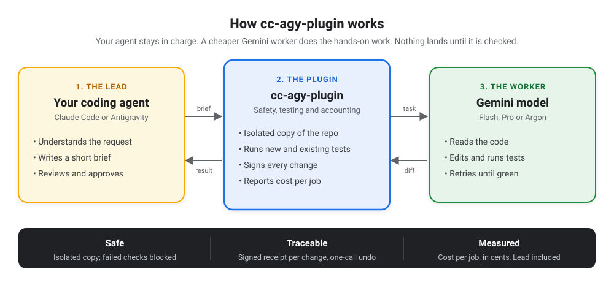

<p align="center">
  
</p>

# cc-agy-plugin

<p align="center">
  <a href="https://github.com/manishkjs/cc-agy-plugin/actions/workflows/validate.yml"></a>
  <a href="LICENSE"></a>
  <a href=".claude-plugin/plugin.json"></a>
  <a href="pyproject.toml"></a>
</p>

**Your coding agent plans and reviews. Gemini workers do the typing.** cc-agy-plugin works inside Claude Code, Cursor, OpenCode, Codex, and Antigravity. When files need to be written, refactored, or debugged, your agent hands a short brief to a Gemini worker that runs in a separate git copy of your repo. The plugin runs your tests on the result, merges only what passes, and writes a signed receipt with the cost in cents.

You keep typing prompts and reviewing diffs the way you do today. In our 26-task benchmark, the cheapest Claude Code setup cost 31% less per task than Opus alone, and it also solved fewer tasks. The [benchmarks](#benchmarks) show every setup, including the ones where the cheaper route solved fewer tasks.

<table>
<tr><td><b>Lower cost per task</b></td><td>Everyday reads, edits, and test retries run on <code>gemini-4-hydrogen</code>. A stronger Gemini model steps in only when a check fails or a retry is needed.</td></tr>
<tr><td><b>A working tree that stays clean</b></td><td>Workers edit a disposable git copy. Nothing reaches your repo until the checks pass and the diff is applied.</td></tr>
<tr><td><b>Checks on every job</b></td><td>The plugin runs your tests when it finds them. With no tests, it falls back to syntax and compile checks for Python, TypeScript/JS, Go, Rust, Bash, and JSON.</td></tr>
<tr><td><b>Receipts you can audit</b></td><td>Every run writes an HMAC-SHA256 signed receipt with token counts and cost in cents. Set a daily spend cap with <code>--max-daily-cents</code>.</td></tr>
<tr><td><b>One-call undo</b></td><td>Each applied job keeps backups of the files it touched, so you can revert that job alone.</td></tr>
<tr><td><b>Four ways to connect</b></td><td>A Gemini Enterprise seat, a Google AI Studio API key, a Vertex AI project, or an AI gateway such as LiteLLM or Bifrost.</td></tr>
<tr><td><b>A free preflight</b></td><td><code>doctor</code> checks credentials, SDKs, git state, and your test runner offline, at 0 tokens.</td></tr>
</table>

---

## Quick install

Paste this into Claude Code or a terminal. It needs Python 3.10 or newer.

```bash
curl -fsSL https://raw.githubusercontent.com/manishkjs/cc-agy-plugin/main/scripts/quickstart.sh | bash
```

The installer asks how you connect and which model preset you want, handles the Gemini Enterprise sign-in if you chose a seat, and runs `doctor`. In Claude Code, run `/reload-plugins` afterwards.

To skip the questions, pass the host and connection yourself:

```bash
curl -fsSL https://raw.githubusercontent.com/manishkjs/cc-agy-plugin/main/scripts/quickstart.sh | bash -s -- --host claude --auth gemini-enterprise
```

`--host` takes `claude`, `cursor`, `opencode`, `codex`, `agy`, or `all`. `--auth` takes `gemini-enterprise`, `api-key`, `vertex`, or `gateway`. Manual installs, version pinning, and sign-in fixes are in the [setup guide](guides/setup.md).

---

## Getting started

Open your project and work normally. All five hosts load the plugin's routing skill, so you do not need to learn tool names. These prompts work as written:

```text
Run doctor to verify my Gemini setup.
Delegate adding input validation to api/orders.py with unit tests, review the diff, and apply it.
Ask Gemini to review my current git diff for edge cases and race conditions.
Revert worker job <job_id>.
```

Claude Code and OpenCode also get slash commands:

| Claude Code | OpenCode | What it does |
|:--|:--|:--|
| `/cc-agy-plugin:setup` | n/a | Pick your connection and model preset, then sign in |
| `/cc-agy-plugin:login` | `/login` | Sign in to Gemini Enterprise, or repair a saved sign-in |
| `/cc-agy-plugin:doctor` | `/doctor` | Readiness check at 0 tokens |
| `/cc-agy-plugin:agy <task>` | `/agy <task>` | Ask Gemini a question or hand it a code edit |
| `/cc-agy-plugin:delegate <task>` | `/delegate <task>` | Run a worker, check the result, apply clean diffs |
| `/cc-agy-plugin:jobs` | `/jobs` | Running and recent jobs with token counts and cost |
| `/cc-agy-plugin:cost` | `/cost` | Gemini spend for this workspace, in cents |

More prompts, and what happens in a project with no tests, are in the [usage guide](guides/usage.md).

---

## How it works

1. You ask for a change the usual way. Your lead agent writes a short brief with plan steps and read-only checks such as `pytest` or `go test`.
2. The plugin copies your tracked and non-ignored files into a standalone git repository. A failed run leaves your working tree untouched.
3. A Gemini worker reads, edits, and runs commands inside that copy.
4. The plugin runs the checks and returns pass and fail counts with a diff.
5. Your lead agent reviews the diff and applies it, or sends follow-up instructions. A receipt records what was applied, and one call undoes it.

Gemini Enterprise seats run through the standalone Antigravity CLI (`agy`). AI Studio keys, Vertex AI projects, and gateways run through the Google Antigravity Python SDK. The plugin picks the right one for you.

---

## When to delegate

The routing skill follows this table, so you rarely need to think about it.

<!-- SHARED:ROUTING_TABLE:BEGIN -->
| Change | Route |
|---|---|
| 1 to 5 files with a known local fix | Edit directly on the Lead outside strict mode; delegate with `delegate_start` when repo exploration, test debugging, or strict mode is active. |
| 6+ files with a clear per-file plan | Read at most 1 to 2 interface files, write `/tmp/<task>-plan.json`, and call `delegate_file_batch`. |
| Open-ended investigation, unknown files, or failing test suite | Delegate on Turn 1 or Turn 2 with `delegate_start` (or `ask_gemini` for a fast single-shot review without a worker copy). |
| One new doc, tests from named cases, or one edit repeated across files | Call `draft_document`, `write_tests_from_cases`, or `replicate_edit`. |
<!-- SHARED:ROUTING_TABLE:END -->

A Flash worker turn is capped at `55` tool calls under `balanced` and `100` under `economy`. Change it with `CC_AGY_FLASH_MAX_TOOL_CALLS`.

---

## Connecting and choosing a profile

| How you connect | Billing | Best fit |
|:--|:--|:--|
| Gemini Enterprise (`--auth gemini-enterprise`) | Included in your monthly Enterprise seat | Work accounts with assigned seats |
| AI Studio key (`GEMINI_API_KEY`) | Pay-as-you-go on AI Studio | Individual developers |
| Vertex AI (`GOOGLE_CLOUD_PROJECT`) | Pay-as-you-go on GCP | Cloud teams and CI/CD pipelines |
| AI gateway (`--base-url`) | Managed by your gateway | Enterprises with a central proxy |

| Profile | How models are chosen | Best when |
|:--|:--|:--|
| `balanced` (default) | Starts on `gemini-4-hydrogen` and moves to `gemini-4-carbon-zero` if a check fails or a retry is needed | Everyday engineering |
| `economy` | Keeps every call on `gemini-4-hydrogen` | Tight budgets and well-scoped tasks |
| `quality` | Starts on `gemini-4-carbon` | Hard multi-file bugs and tricky logic |

Set the profile with `--profile` or `CC_AGY_COST_PROFILE`. A few flags keep you in charge:

- `--no-auto-apply` holds every diff until you approve it.
- `--max-daily-cents 500` sets a UTC daily spend cap.
- `--allowed-projects` and `--blocked-projects` decide which GCP projects may be billed.
- `--strict` blocks direct edits in Claude Code so every changed line traces to a signed worker receipt.

Every flag and environment variable is in the [configuration guide](guides/configuration.md).

---

## Benchmarks

We ran 26 real repository tasks (10 Python, 10 Go, 6 TypeScript) across 8 setups. Each setup ran each task once, so differences of 1 to 3 tasks are within normal run-to-run noise.

| Setup | Tasks solved | Avg cost / task | vs Opus solo |
|:--|:--:|:--:|:--:|
| Claude Code · Opus 5.5 (solo) | 22 / 26 | 87.6¢ | baseline |
| Claude Code + plugin · Opus + Flash (`economy`) | 15 / 26 | 60.6¢ | -31% |
| Claude Code + plugin · Flash 3.8 -> Argon (`balanced`) | 21 / 26 | 81.1¢ | -7% |
| Claude Code + plugin · Opus + Argon (`quality`) | 20 / 26 | 80.0¢ | -9% |
| Antigravity · Flash (solo) | 18 / 26 | 47.7¢ | -46% |
| Antigravity · Flash -> Carbon Low | 18 / 26 | 74.9¢ | -14% |
| Antigravity · Carbon Zero-Think (solo) | 20 / 26 | 93.9¢ | +7% |
| Antigravity + plugin · Argon + Flash (`economy`) | 15 / 26 | 83.2¢ | -5% |

Opus alone still solves the most tasks. Hidden-test pass counts, per-language splits, and how the runs were priced are in the [full results](guides/benchmarks.md).

Prefer video? Watch the [4m 30s walkthrough](assets/walkthrough.mp4).

---

## Documentation

| Guide | What it covers |
|:--|:--|
| [Setup](guides/setup.md) | One-command install, manual flags for each host, sign-in fixes, verifying the install |
| [Usage](guides/usage.md) | Example prompts, slash commands, projects without tests |
| [Configuration](guides/configuration.md) | Connection modes, profiles, spend and project controls, Gemini Enterprise options, every flag and env var |
| [Benchmarks](guides/benchmarks.md) | All 8 setups, the Antigravity before and after, pricing and routing notes |
| [FAQ](guides/faq.md) | Sandboxing, undo, spend caps, quota errors, where receipts live |
| [Technical reference](guides/reference.md) | Architecture, rate card, the 18 MCP tools, batch file writing, guard hooks, repository layout, running tests |

---

## Status

| Item | Detail |
|:--|:--|
| **Version** | 0.4.2, Apache 2.0 |
| **Quality** | Automated unit, integration, portability, and guardrail suite (`pytest tests/ -q`; `scripts/validate.sh` checks manifests and synced docs) |
| **Known gap** | If another process force-kills the plugin server (`SIGKILL`), unapplied worker edits in temporary copies are not auto-applied |

## License

Licensed under the Apache License 2.0. See [LICENSE](LICENSE).

## Acknowledgments

Special thanks to Vamsi Ramakrishnan ([github.com/vamsiramakrishnan/straitjacket](https://github.com/vamsiramakrishnan/straitjacket)) for building Straitjacket, whose bounded command execution and addressable evidence retrieval architecture inspired and powers our worker containment pipeline.
