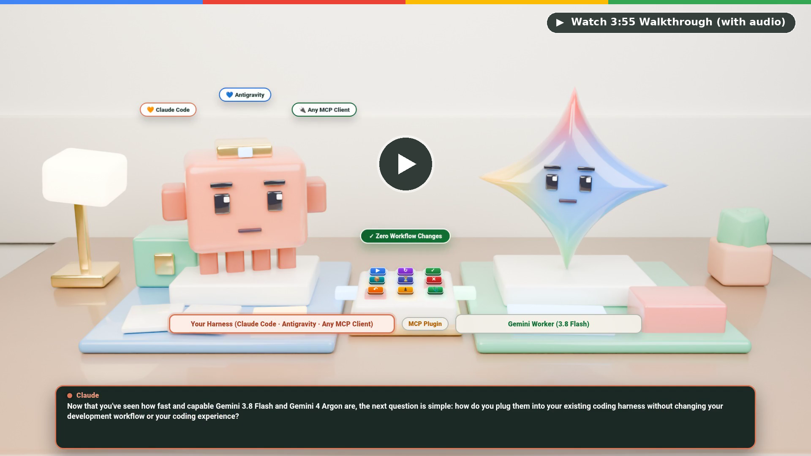
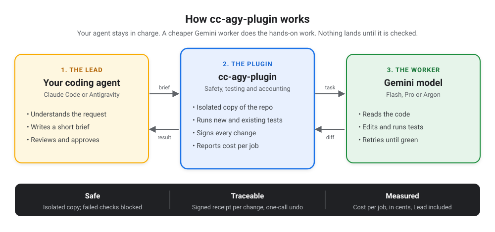
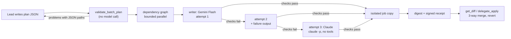

<div align="center">

# cc-agy-plugin

**Cut coding agent token spend by 20% to 50% in Claude Code, Antigravity (`agy`), and Codex by delegating file edits and test loops to fast, low-cost Gemini workers in an isolated git copy.**

[](LICENSE)
[](.claude-plugin/plugin.json)
[](tests/)
[](pyproject.toml)
[](#quick-start)

[Why use it](#why-use-it) · [Video walkthrough](#video-walkthrough) · [Quick start](#quick-start) · [How to use it](#how-to-use-it) · [Options](#options) · [Benchmark results](#benchmark-results) · [Technical reference](#technical-reference)

</div>

## Why use it

You already work inside **Claude Code (`claude`)**, **Antigravity (`agy` CLI / Antigravity IDE)**, or **Codex (`codex`)**. Installing `cc-agy-plugin` cuts your per-task token bill by **20% to 50%** by routing everyday file reads, edits, and test retries to **Gemini Flash** (`gemini-flash-next`, `50¢` in / `300¢` out per 1M tokens) and stepping up to **Gemini 4 Argon** (`200¢` / `1,200¢`) only when checks fail, without changing how you type prompts or review diffs. Based on how you connect, the plugin automatically uses the standalone **Antigravity CLI (`agy`)** for included **Gemini Enterprise** seats or the **Google Antigravity Python SDK** for **AI Studio** and **Vertex AI**.

Your main agent (whether Claude Opus in Claude Code or Gemini Argon / Carbon in Antigravity) stays in charge of planning and code review. When files need to be written, refactored, or debugged, it hands a short brief to a Gemini worker inside a separate git copy of your repo. The plugin checks that your code compiles and passes tests, merges only verified changes back into your workspace, and writes a signed cost receipt with a one-call undo.

| Without `cc-agy-plugin` | With `cc-agy-plugin` (in Claude Code, Antigravity, or Codex) |
|:--|:--|
| Your lead model (Opus at `400¢`/`2,000¢` or Argon/Carbon at `200¢`/`1,200¢`) pays top-tier token rates to read files, type boilerplate, and retry failing tests | **20% to 50% lower cost:** your lead model plans and reviews while **Gemini Flash** (`50¢`/`300¢`) handles everyday edits and steps up to **Gemini 4 Argon / Carbon** only on hard failures (`-31%` in Claude Code, `-20%` to `-50%` in Antigravity, and `-24%` even with Argon on both Lead and Worker) |
| Failed or interrupted edits leave half-finished changes in your working tree | Workers edit an isolated git copy; broken builds or failed checks never auto-apply |
| Projects without unit tests get no safety net before edits land | Built-in syntax and compile smoke checks still gate Python, TypeScript/JS, Go, Rust, Bash, and JSON changes |
| Monthly API bills arrive as a surprise with no per-task cap | Per-job receipts in US cents, full lead + worker session totals, and an optional daily spend cap (`--max-daily-cents`) |
| No easy way to roll back just one agent run | Every applied job saves pre-edit file backups for a clean one-call revert |

## Video walkthrough

Click the preview below to open the **4m 30s voiced 3D walkthrough** ([`assets/walkthrough.mp4`](assets/walkthrough.mp4), 1080p with audio and burned-in captions):

<p align="center">
  <a href="assets/walkthrough.mp4">
    
  </a>
</p>

- **`0:00` Keep your workflow:** How Claude Code, Codex, or any MCP client stays in charge while Gemini runs heavy edits next door.
- **`0:32` Enterprise seats via `agy` CLI vs. pay-as-you-go:** How teams on Gemini Enterprise run on their included seats after installing and signing into the Antigravity CLI (`agy`) once, how pay-as-you-go keys work automatically, and why that beats a harness-locked Claude subscription.
- **`1:07` Isolated git copy and 18 MCP tools:** How `delegate_start`, `delegate_file_batch`, and zero-token `doctor` checks work.
- **`1:58` Four cost-saving habits and Argon step-up:** Cached repo maps, bounded log storage, starting on `gemini-3.8-flash`, and stepping up to `gemini-4-argon` on retries.
- **`3:04` Benchmark walkthrough:** Side-by-side pass rates and cost in cents across Aider Python, SymPy, and DeepSWE repository tasks.

## Quick start

Setup takes about a minute in a normal terminal shell. The installer automatically sets up either the standalone Antigravity CLI (`~/.local/share/cc-agy-plugin/bin/agy`) for Gemini Enterprise seats or an isolated Python environment (`~/.local/share/cc-agy-plugin/venv`) for AI Studio and Vertex AI, so you never hit `externally-managed-environment` (PEP 668) errors on Debian, Ubuntu, or macOS Homebrew, and secrets are never written to config files.

### 1. Clone the repository

```bash
git clone https://github.com/manishkjs/cc-agy-plugin && cd cc-agy-plugin
```

### 2. Install for Claude Code, Codex, or Antigravity (pick your connection)

Run one of the commands below in a normal terminal shell (or run `python3 -m server.install` with no flags for a 4-question interactive wizard):

**Option A: Gemini Enterprise work subscription (uses your included monthly seat)**
```bash
# Install for Claude Code, Codex, or Antigravity (--host claude | codex | agy | all)
# and download ~/.local/share/cc-agy-plugin/bin/agy:
python3 -m server.install --host claude --auth gemini-enterprise
# Or install directly into Antigravity CLI / IDE (~/.gemini/config/):
python3 -m server.install --host agy --auth gemini-enterprise

# Sign in once in a terminal with your work Google account (then type /exit or Ctrl+C):
~/.local/share/cc-agy-plugin/bin/agy
```

**Option B: Google AI Studio API key (fastest personal setup, pay-as-you-go)**
```bash
export GEMINI_API_KEY="your-key"
python3 -m server.install --host claude   # or --host codex, --host agy, or --host all
```

**Option C: Google Cloud Vertex AI project (pay-as-you-go)**
```bash
gcloud auth application-default login
export GOOGLE_CLOUD_PROJECT="your-gcp-project-id"
python3 -m server.install --host claude   # or --host codex, --host agy, or --host all
```

> [!TIP]
> **One install, automatic backend routing:** Gemini Enterprise seats run through the standalone `agy` CLI, while AI Studio keys, Vertex AI projects, and gateways run through the Python SDK. Passing `--host agy` (or `--host all`) registers the `agy` MCP server in `~/.gemini/config/mcp_config.json`, installs the routing skill in `~/.gemini/config/skills/cc-agy-plugin/SKILL.md`, and writes a native Antigravity plugin bundle in `~/.gemini/config/plugins/cc-agy-plugin/`. See [Options](#options), [Authentication precedence](#authentication-precedence), and the [Configuration reference](#configuration-reference) for flags and fallback rules.

If `claude` is already open in another terminal tab, run `/reload-plugins` inside that session (or restart with `claude --continue`), or prefix shell commands inside Claude Code with `!`.

### 3. Verify your setup (free, 0 tokens)

- **In Claude Code:** type `/cc-agy-plugin:doctor`
- **In Codex:** start `codex` in your project and ask: `"Run doctor to verify my Gemini setup."`
- **In Antigravity (`agy` CLI or IDE):** start `agy` in your project (or run `agy mcp list` to confirm `agy` is registered) and ask: `"Run doctor to verify my Gemini setup."`

## How to use it

<p align="center">
  
</p>

Once installed, open your project in Claude Code, Codex, or Antigravity and work normally. All three hosts load the plugin's routing skill automatically, so you do not need to memorize internal MCP tool names.

### Plain-English prompts you can type right away

| What you want to do | Example prompt | What happens behind the scenes |
|:--|:--|:--|
| **Check your setup (free)** | *"Run doctor to verify my Gemini setup."* (or `/cc-agy-plugin:doctor` in Claude Code) | Verifies credentials, active `cost_profile`, installed SDKs, git status, and detected test runner offline at **0 tokens**. |
| **Fix a bug or build a feature** | *"Delegate adding input validation to `api/orders.py` with unit tests, review the diff, and apply it."* | Runs `gemini-flash-next` in an isolated git copy (`delegate_start`), runs checks, lets your lead agent inspect `get_diff`, and merges with `delegate_apply`. |
| **Edit many files from one plan (6+ files)** | *"Plan the new webhook handlers across all 8 files and write them with `delegate_file_batch`."* | Validates the plan locally, writes files in parallel with per-file verification, retries failures automatically, and returns one combined diff. |
| **Get a fast second opinion** | *"Ask Gemini to review my current git diff for edge cases and race conditions."* | Sends a single-shot `ask_gemini` query without spinning up a worker copy or touching files. |
| **Undo an applied worker job** | *"Revert worker job `<job_id>`."* | Restores every file touched by that job from its signed pre-apply backup (`delegate_revert`) if no newer manual edits conflict. |

### Slash commands in Claude Code

| Slash command | What it does |
|:--|:--|
| `/cc-agy-plugin:doctor` | Offline readiness check for credentials, SDKs, `cost_profile`, git workspace, and test runner (zero token cost). |
| `/cc-agy-plugin:delegate <task>` | Hands `<task>` to an isolated Gemini worker, verifies checks, inspects the diff, and applies clean results. |
| `/cc-agy-plugin:jobs` | Shows running and recent worker jobs, modified files, token counts, and cost in cents. |
| `/cc-agy-plugin:cost` | Reports workspace Gemini spend in cents (pass `--true-total` to include your Claude Code lead session). |

### What if my project does not have tests yet?

Every worker digest reports a `verification` mode so you always know how changes were checked:
- **Projects with tests (`verification: "acceptance_tests"`):** The plugin auto-detects and runs scoped tests across Python (`pytest`, `unittest`), TypeScript/JavaScript (`vitest`, `jest`, `node --test`), Go (`go test`), Rust (`cargo test`), Java/Kotlin (`gradlew`, `mvnw`, `mvn`), and `Makefile`.
- **Projects without tests (`verification: "smoke_only"`):** When no test command is given or detected, the plugin runs fast read-only syntax and compile checks on every changed file (Python parse and import, `tsc --noEmit` with your repo's TypeScript, `node --check`, `go build`, `cargo check --offline`, `bash -n`, and JSON validation). Files that fail to parse or compile are rejected and escalated to `gemini-4-argon`. When smoke checks pass, the digest instructs your lead agent to review the diff line-by-line against your request before finishing.

## Options

### Connection modes

| How you connect | Backend | Enterprise seat? | Billing | Best fit |
|:--|:--:|:--:|:--|:--|
| **Gemini Enterprise** (`--auth gemini-enterprise`) | Standalone `agy` CLI | **Yes** | Included in monthly Enterprise Standard/Plus seat | Work accounts with assigned Gemini Enterprise seats. |
| **AI Studio key** (`GEMINI_API_KEY`) | Python SDK | No | Pay-as-you-go on AI Studio | Individual developers without Google Cloud setup. |
| **Vertex AI** (`GOOGLE_CLOUD_PROJECT`) | Python SDK | No | Pay-as-you-go on GCP (`aiplatform.googleapis.com`) | Cloud teams, Service Accounts, and CI/CD pipelines. |
| **AI gateway** (`--base-url`) | Python SDK | Gateway-defined | Managed by your gateway (`LiteLLM`, `Portkey`, `Bifrost`, Apigee) | Enterprises routing model traffic through a central proxy. |

See [Authentication precedence](#authentication-precedence) for exact credential selection order when multiple variables are set.

### Model and cost profiles (`--profile` or `CC_AGY_COST_PROFILE`)

| Profile | How models are chosen | Best when |
|:--|:--|:--|
| **`balanced`** *(default)* | Starts on fast, low-cost **`gemini-flash-next`**. Steps up automatically to **`gemini-4-argon`** on the same git copy if a check fails or a retry is needed, then returns to Flash on the next new task. Quota errors (`429` / `503`) stop automatic retries and hand control back to your lead agent. | Everyday engineering where you want Flash speed and pricing with Argon backup on hard bugs. |
| **`economy`** | Keeps all worker and `ask_gemini` calls on **`gemini-flash-next`** and turns off automatic step-up to Argon. | Tight budgets, boilerplate generation, docs, and well-scoped tasks. |
| **`quality`** | Starts all worker and `ask_gemini` calls directly on **`gemini-4-argon`** with deeper reasoning from turn one. | Complex multi-file architecture bugs, subtle concurrency fixes, or tricky math/logic changes. |

### You stay in full control

Every model call, file edit, and spend ceiling is governed by explicit settings you control:

| Control | How to set it | Guarantee |
|:--|:--|:--|
| **1. Lock connection & billing mode** | `--auth gemini-enterprise\|api-key\|vertex\|gateway` (`CC_AGY_AUTH_MODE`) | Explicit `--auth` never falls back to another backend; if `auto` picks Vertex AI from a shell env var, `doctor` warns you upfront. |
| **2. Allow or block GCP projects** | `--allowed-projects` / `--blocked-projects` (`CC_AGY_ALLOWED_PROJECTS`, `CC_AGY_BLOCKED_PROJECTS`) | Blocks unapproved GCP projects at **0 tokens** across Vertex AI, `gcloud` ADC `quota_project_id`, and `agy` CLI `onboarding.json` (`cloudaicompanionProject`), and scrubs ambient `GOOGLE_CLOUD_PROJECT` vars from `agy` subprocesses. |
| **3. Hard spend ceiling & model tier** | `--max-daily-cents 500` + `--profile economy\|balanced\|quality` | Enforces a UTC daily spend cap in cents and stops automatic retries immediately on `429` / `503` quota errors. |
| **4. Isolated git copy + review before apply** | Default outside `--strict`, or force everywhere with `--no-auto-apply` (`CC_AGY_AUTO_APPLY_ON_PASS=0`) | Workers run in disposable git copies, `in_place=true` and shutdown salvage are disabled when `--no-auto-apply` is set, and nothing touches your repo until `delegate_apply`. |
| **5. File scope & one-call undo** | `allowed_paths=[...]` + `delegate_revert` / `delegate_cancel` | Rejects out-of-scope file edits and restores every touched file from its HMAC-signed pre-apply backup in one call. |
| **6. Zero-token preflight audit** | `/cc-agy-plugin:doctor` (or `"Run doctor"`) | Reports active auth mode, pinned status, active/companion GCP project, allow/block lists, spend cap, and manual-apply policy offline at **0 tokens**. |

### Installer flags and runtime configuration

Pass `--host codex|claude|agy|all`, `--auth`, `--profile`, `--project`, `--allowed-projects`, `--blocked-projects`, `--no-auto-apply`, `--location`, `--base-url`, `--max-daily-cents`, or `--strict` to `python3 -m server.install` (or run `claude --plugin-dir /path/to/cc-agy-plugin` for a single session). All CLI flags, `userConfig` keys, and `CC_AGY_*` environment variables are listed in one place in the [Configuration reference](#configuration-reference).

## Benchmark results

Paired cross-language benchmark across 26 real repository tasks (10 Python DeepSWE repos, 10 Go Aider Polyglot + Multi-SWE-bench `cli/cli` tasks, and 6 TypeScript Multi-SWE-bench + DeepSWE tasks, 208 runs across 8 setups at `n=1` per setup), priced at Opus 5.5 (`400¢` in / `20¢` cached / `2,000¢` out per 1M tokens), Gemini 4 Argon & Carbon (`200¢` / `20¢` / `1,200¢`), and Gemini Flash (`50¢` / `5¢` / `300¢`). "Flash" below means `gemini-flash-next`; only the `balanced` row still uses `gemini-3.8-flash`. All `cc-agy-plugin` worker calls, Claude Code proxy runs, and `v9`/`v10`/`v12` Antigravity runs route through free internal Cloud Code PA (`aipp-internal-testing`) with `0` BAIC calls; only `v13`'s standalone `agy` CLI Argon Lead authenticated via Gemini Enterprise BAIC (`businessaicode.googleapis.com`, `quotaProject=deep-clock-339817`, `0` `aiplatform.googleapis.com` calls, Vertex billing status `Unverified`), while the older standalone `AGY · Argon (solo)` baseline has no CLI logs on disk (routing `Unverified`).

| Setup | Tasks solved | Hidden tests passed | Avg cost / task | vs Opus solo | Avg time | Best fit |
|:--|:--:|:--:|:--:|:--:|:--:|:--|
| Claude Code · Opus 5.5 (solo) | 22 / 26 | 806 / 891 | 87.6¢ | baseline | 4m 12s | Baseline · All-Opus in Claude Code (TypeScript generics 6 / 6 at 71.3¢) |
| Claude Code + plugin · Opus + Flash (`economy`) | 15 / 26 | 797 / 891 | 60.6¢ (22¢ + 39¢) | -31% | 5m 37s | Stay in CC, cut spend 31% (5 / 6 TS, 7 / 10 Go, 797 / 891 tests) |
| Antigravity · Flash -> Carbon Low | 18 / 26 | 810 / 891 | 74.9¢ ($0 Claude) | -14% | 7m 15s | Pure AGY 2-tier (18 / 26, 810 / 891 tests vs 806 Opus, 7 / 10 Py & Go, -14%) |
| Antigravity · Carbon Zero-Think (solo) | 20 / 26 | 846 / 891 | 93.9¢ ($0 Claude) | +7% | 7m 31s | Pure AGY Carbon 0-Think (94.9% tests vs 90.5% Opus; 9 / 10 Python, 7 / 10 Go) |
| Claude Code + plugin · Flash 3.8 -> Argon (`balanced`) | 21 / 26 | 855 / 891 | 81.1¢ (21¢ + 61¢) | -7% | 7m 45s | Highest CC + plugin pass rate (10 / 10 Python at -14% cost; Go -15%) |
| Claude Code + plugin · Opus + Argon (`quality`) | 20 / 26 | 865 / 891 | 80.0¢ (22¢ + 58¢) | -9% | 5m 37s | Highest holdout test pass rate (97.1% overall; 99.8% on Python) |
| Antigravity · Flash (solo) | 18 / 26 | 841 / 891 | 47.7¢ ($0 Claude) | -46% | 6m 39s | Pure AGY Flash + plugin harness (18 / 26, 841 / 891 tests, 9 / 10 Python -53%, 6 / 10 Go -52%) |
| Antigravity + plugin · Argon + Flash (`economy`) | 15 / 26 | 673 / 891 | 83.2¢ (49¢ + 34¢, $0 Claude) | -5% | 8m 34s | Interactive Argon Lead + Flash worker in AGY (4 / 6 TS, 7 / 10 Go, -45% Python avg vs Argon solo, -3 solves overall) |

**TL;DR for sellers** (26 real coding tasks; Claude Opus 5.5 alone costs 87.6¢ per task):

- **Staying in Claude Code?** Add the Plugin. Opus plans, Gemini Flash writes the code: **31% cheaper** (60.6¢ vs 87.6¢ per task).
- **Moving to Antigravity?** Gemini Flash alone solves 18 of 26 and passes **more hidden tests than Opus** (841 vs 806) at **about half the cost** (47.7¢, -46%).
- **Need the most solves on Gemini?** Gemini Carbon with zero thinking solves **20 of 26** and passes 846 hidden tests (Opus: 806), at roughly Opus price (93.9¢, +7%).
- **Opus still solves the most tasks** (22 of 26). Each setup ran each task once, so differences of 1 to 3 tasks are within normal run-to-run noise.

Per-language numbers, failure analysis, and engineering lessons are in [`docs/design/lessons-learned.md`](docs/design/lessons-learned.md#benchmark-findings-detail) and the interactive dashboard ([`docs/brownfield_gemini_benchmark.html`](docs/brownfield_gemini_benchmark.html)).

### Using `cc-agy-plugin` inside Antigravity: before vs. after

Installing `cc-agy-plugin` directly into Antigravity (`python3 -m server.install --host agy`) delivers four measured setups without paying any Claude Code lead overhead (`$0.00` Claude tokens):

| Antigravity scenario | Without `cc-agy-plugin` | With `cc-agy-plugin` | Measured gain |
|:--|:--|:--|:--|
| **1. `gemini-flash-next` across 26 tasks (`v10` raw vs. `v12` plugin harness)** | `7 / 26` solved (`26.9%`), `173 / 891` holdout tests (`19.4%`), `0 / 10` on Python, `103.5¢` per solved task | **`18 / 26` solved (`69.2%`)**, **`841 / 891` holdout tests (`94.4%`)**, **`9 / 10` on Python**, `47.7¢` avg (`68.9¢` per solve) | **+11 tasks (+157% solves), +668 tests, -33% cost per solve** (`-49%` avg cost vs. standalone Carbon Zero-Think's `93.9¢`, and **`-61%` on Python** at `72.4¢` vs. `186.1¢`) |
| **2. 2-tier `Flash -> Carbon Low` (`v12`) vs. standalone `Carbon Zero-Think` (`v9`, 26 tasks)** | `93.9¢` avg / task (`186.1¢` on Python, `45.7¢` on Go, `7 / 10` Go solves) | **`74.9¢` avg / task** (`118.7¢` on Python, **`32.6¢` on Go**, `7 / 10` Go solves, `5 / 5` Aider Go at `3.1¢`), `18 / 26` solved (`810 / 891` tests = `90.9%`) | **-20% average cost across 26 tasks** (`-36%` on Python, **`-29%` on Go**, and `-80%` on Aider Go) by keeping first-pass edits on Flash and stepping up to Carbon Low only when checks fail |
| **3. `Antigravity · Argon` Lead delegating to isolated worker vs. standalone `Argon` (16 Python DeepSWE tasks)** | `10 / 16` solved (`62.5%`), `580` total turns, `3,084¢` total (`192.8¢` / task, `308.4¢` / solve) | **`11–12 / 16` solved (`68.8%–75.0%`)**, `433` total turns, **`2,352¢` total (`147.0¢` / task**, `196.0¢–213.8¢` / solve) | **-24% total cost, -30% to -36% cost per solve, -25% turns, and +1 to +2 extra tasks solved** purely from isolated git worktree delegation and Straitjacket log containment |
| **4. `Antigravity · Argon` Lead + Flash worker (`economy` `v13`) vs. standalone `Argon` (`docs/live_r1_iter2`, `docs/live_r6_go`, `docs/live_r7_ts`, 2026-10-21..23, 26 tasks)** | `18 / 26` solved (`69.2%`), `785 / 891` holdout tests, `81.1¢` avg / task (`155.0¢` Python [`193.8¢`/solve], `27.1¢` Go, `47.8¢` TypeScript), `5m 17s` avg | **`15 / 26` solved (`57.7%`)**, `673 / 891` holdout tests, **`83.2¢` avg / task** (`49.0¢` Lead + `34.2¢` Worker, `144.2¢` / solve; **`85.3¢` on Python** [`213.3¢`/solve], `62.3¢` on Go, `114.5¢` on TypeScript [`4 / 6`]), `8m 34s` avg | **-45% avg cost on Python DeepSWE** (`85.3¢` vs. `155.0¢`, `+10%` per solve) and **+1 extra TypeScript solve** (`4 / 6` vs. `3 / 6`, adding `vuejs-10161` while retaining `darkreader-6747`, `darkreader-7241`, and `vuejs-11694`), with **-3 solves (`15 / 26` vs. `18 / 26`, -112 net holdout tests: -115 across 4 short-Lead-loop Python runs [`2-7` Lead turns, `4.1¢-10.3¢` Lead each], +15 on `tomlkit`, -12 on `koota`) where the run failed the new holdout suite (`aiomonitor` `2/54`, `psd-tools` `7/45`, `mobly` `61/83`, `httpx` `119/122`)**, while **7 long Lead loops (`5` solved, `2` unsolved; `1,009¢` of `1,273¢` Lead spend) drove +2.6% avg cost (`+130%` Go, `+140%` TS) and +62% wall time**, making autonomous `AGY · Flash (solo)` (`47.7¢`, `18 / 26`) the cheaper Antigravity default |

> [!NOTE]
> Each setup ran once per task (`n=1`) in the 26-task cross-language suite, so 1-to-3 task solve differences sit within single-run variance (`v13`'s -3 net solves vs. standalone Argon solo came from 4 short-Lead-loop Python runs [`aiomonitor` `2/54`, `psd-tools` `7/45`, `mobly` `61/83`, `httpx` `119/122`: `2-7` Lead turns] where the run failed the new holdout suite, offset by `+1` TypeScript solve [`vuejs-10161`], while multi-turn Lead loops on 7 long tasks drove the extra cost and wall time). All Flash worker calls, Claude Code proxy runs, and `v9`/`v10`/`v12` Antigravity runs are wire-reconciled against free internal Cloud Code PA (`aipp-internal-testing`) token logs with `0` BAIC calls and `0` post-exit orphan calls (on `cli__cli-6578`, the `v13` Argon Lead ran `rm -rf api/queries_user_test.go .cc-agy-data` before receipt copy, so its 37 worker calls / `37.06¢` were backfilled directly from the CCPA wire log with `0.00¢` delta by construction). Only `v13`'s standalone `agy` CLI Argon Lead ran over Gemini Enterprise BAIC (`businessaicode.googleapis.com`, `quotaProject=deep-clock-339817`, `0` `aiplatform.googleapis.com` calls, Vertex billing status `Unverified`) and is priced from transcripts (`374` priced turns out of `405` BAIC HTTP requests; `31` requests have no matching usage record), while the older standalone `AGY · Argon (solo)` baseline (`live_r1_iter2`, `live_r6_go`, `live_r7_ts`) has no CLI logs on disk (routing `Unverified`).

## Status

| Item | Detail |
|:--|:--|
| **Version** | 0.3.0, Apache 2.0 |
| **Quality** | Automated unit, integration, portability, and guardrail suite (`pytest tests/ -q`; `scripts/validate.sh` checks manifests and synced docs) |
| **Known gap** | If another process force-kills the plugin server (`SIGKILL`), unapplied worker edits in temporary copies are not auto-applied |

---

## Technical reference

Internals, rate cards, and full tool documentation for engineers. Click any section below to expand it.

<details>
<summary><b>Architecture and rate card</b></summary>


`cc-agy-plugin` connects Claude Code, Codex, and MCP clients to the standalone Antigravity CLI (`agy`) or Google Antigravity Python SDK so one workspace combines a lead planner/reviewer with Gemini workers:

1. **Your lead agent plans and reviews**:
   - Reads the user prompt, inspects key interfaces, and writes a short outcome-only task brief with ordered `plan` steps and read-only `acceptance` checks (`pytest`, `ruff`, `mypy`, `go test`, `vitest`).
   - Reviews the token-paginated git diff returned by the worker and decides whether to merge it (`delegate_apply`) or send follow-up instructions (`delegate_continue`).
2. **Antigravity (`agy` CLI or Python SDK) + Straitjacket executes the task**:
   - Spins up a headless Antigravity worker inside an isolated git copy (see *End-to-end flow* below for isolation and `in_place=true` details).
   - **Straitjacket (`ctx-harness`) shell containment** intercepts noisy test and build outputs (>400 lines or >6,000 tokens), stores them in a local evidence store (`run:<id>#stdout`), and gives the worker `ctx_get` and `ctx_search` tools so a single failing test suite does not flood the worker's context window.

### Configured rate card

Configured Gemini model rates in `server/regions.py` and Claude lead rates in `server/true_cost.py` per 1M tokens (for single model calls exceeding `200,000` prompt tokens on Pro/Argon models, such as `ask_gemini` with `single_request=True` or an individual per-step call, input rates scale by `2.0x` and output rates by `1.5x`; multi-call worker turns accumulate smaller per-step prompts at the standard rate):

| Model | Role | Uncached Input / 1M | Cached Input / 1M | Output / 1M |
|---|---|---|---|---|
| **Claude Opus 5.5** | Lead Planner & Reviewer (`server/true_cost.py`, override via `CC_AGY_LEAD_RATES`; legacy Opus 4.x/5.0 at 500¢ / 50¢ / 2,500¢) | 400¢ | 20¢ | 2,000¢ |
| **Gemini Flash** (`gemini-flash-next`) | Default Worker & Review Model (`balanced` / `economy`) | 50¢ | 5¢ | 300¢ |
| **Gemini 4 Argon** | Escalation & `quality` Profile Reasoning Worker | 200¢ | 20¢ | 1,200¢ |
| **Gemini 3.1 Pro** | Supported Pro Preview Model | 200¢ | 20¢ | 1,200¢ |
| **Gemini 2.5 Flash** | Supported Regional Review Model | 30¢ | 3¢ | 250¢ |

---

</details>

<details>
<summary><b>Authentication precedence and retry rules</b></summary>

<a id="authentication-precedence"></a>

### Authentication precedence

Google's Cloud Code server guardrail permits Gemini Enterprise business OAuth seats on the standalone Antigravity CLI (`agy`) while rejecting direct SDK traffic (`"The Antigravity SDK is not available on an enterprise account. Use a Vertex AI API key instead."`). `resolve_auth_config()` in `server/regions.py` selects credentials in this exact order:
1. Explicit `api_key` argument on the tool call -> **Google AI Studio** (`auth_mode="api_key"`, Python SDK).
2. Gemini Enterprise subscription mode (`CC_AGY_AUTH_MODE=gemini_enterprise`, `--auth gemini-enterprise` / `agy-cli`, `CC_AGY_GEMINI_ENTERPRISE=true`, or `userConfig.auth_mode="gemini_enterprise"`) -> **Standalone Antigravity CLI (`agy`)** (`auth_mode="gemini_enterprise"`). Locates or SHA-512-installs `~/.local/share/cc-agy-plugin/bin/agy` (skipping Google-internal `jetski` builds), verifies local Google sign-in (`~/.gemini/antigravity-cli/antigravity-oauth-token`, `cache/onboarding.json`, or `ANTIGRAVITY_OAUTH_TOKEN`), and runs headless `agy` subprocesses (`--output-format stream-json` for workers, `--output-format json --mode plan` for `ask_gemini` and structured batch writers).
3. Explicit `project` argument on the tool call -> **Vertex AI** (`auth_mode="vertex"`, Python SDK).
4. Custom AI gateway base URL (`CC_AGY_VERTEX_BASE_URL`, `GOOGLE_VERTEX_BASE_URL`, or `userConfig.vertex_base_url`) -> **Vertex-compatible AI Gateway** (`auth_mode="vertex"`, defaulting `project` to `"custom-endpoint"` when no GCP project ID is set, and attaching `CC_AGY_VERTEX_BASE_URL_TOKEN` when configured). Takes priority over an ambient shell `GEMINI_API_KEY`.
5. `GEMINI_API_KEY`, `GOOGLE_API_KEY`, or `userConfig.gemini_api_key` in the environment -> **Google AI Studio** (`auth_mode="api_key"`, even if `GOOGLE_CLOUD_PROJECT` is also exported in the shell).
6. `GOOGLE_CLOUD_PROJECT`, `VERTEX_PROJECT`, `GCLOUD_PROJECT`, `CLOUD_ML_PROJECT_ID`, or `userConfig.google_cloud_project` in the environment -> **Vertex AI** (`auth_mode="vertex"`).
7. Automatic `agy` CLI fallback (`auto` mode when none of 1 to 6 are set) -> **Standalone Antigravity CLI (`agy`)** (`auth_mode="gemini_enterprise"`) when an external `agy` binary and local Google sign-in are present.

### Retry, thinking-level, and override mechanics

Profile goals (`balanced`, `economy`, `quality`) are summarized in [Options](#options). Additional runtime mechanics:
- **Default reasoning depth**: Mutating worker turns use `LOW` thinking on `gemini-flash-next`, `LOW` on escalated `gemini-4-argon` turns in `balanced`, `MEDIUM` on `gemini-4-argon` in `quality`, and `HIGH` on read-only worker turns (override via `thinking_level` or `CC_AGY_DELEGATE_THINKING_LEVEL`).
- **Quota short-circuit**: Worker `429` or `503` quota errors set `escalation.escalate_to_lead=true` (`reason="quota_or_rate_limit"`) immediately without burning retry turns unless `force_retry=true` is passed.
- **Per-call overrides**: Pass `model="gemini-flash-next"` or `model="gemini-4-argon"` per call, or set `CC_AGY_DEFAULT_DELEGATE_MODEL` / `CC_AGY_DEFAULT_ASK_MODEL`.

---

</details>

<details>
<summary><b>End-to-end flow (hooks, MCP, isolation, provenance)</b></summary>

1. **Hook pre-flight check (`scripts/pre_tool_guard.py`)**:
   - A pre-flight linter rejects delegation prompts (or `plan` steps) containing more than 8 consecutive lines of code so the lead agent writes concise outcome briefs instead of pasting full implementations into the prompt.
   - When strict mode is enabled (`CC_AGY_STRICT_MODE=true` or `userConfig.strict_delegation_mode=true`), Claude Code's direct `Edit`/`Write`/`MultiEdit`/`NotebookEdit` tools and mutating `Bash` commands on workspace files are blocked so implementation work goes through Gemini workers.
2. **MCP stdio request (`server/mcp_stdio.py`)**:
   - The host sends JSON-RPC 2.0 `tools/call` messages over `stdin` to the plugin's persistent Python process.
   - An 8-worker thread pool dispatches `tools/call` requests concurrently (up to 8 simultaneous in-flight tool calls) so `delegate_status`, `ping`, and `delegate_cancel` can respond while a worker job is running.
3. **Working-copy isolation vs. `in_place` execution (`server/jobs.py`, `server/agy_runner.py`)**:
   - **Isolated copy (default, `in_place=false`)**: `JobManager` copies tracked and non-ignored files (`git ls-files -co --exclude-standard -z`) into a standalone git repository under `<data_dir parent>/.cc-agy-worktrees-<slug>/<job_id>` (falling back to `/tmp/cc-agy-worktrees-<slug>/<job_id>`) and creates a baseline commit (`git init -b main`). Multiple jobs can run in parallel and failed runs leave your working tree untouched. Host `.git/hooks` and `.git/config` are snapshot-verified around every run. For TypeScript and Node workspaces, isolated copies populate `node_modules` via copy-on-write clones or bounded package copies (`<= 10,000` entries and `<= 128 MiB`), skip host symlinks during `--dangerously-skip-permissions` `agy` CLI runs on oversized non-CoW trees, and verify host `node_modules` metadata after shallow-symlink SDK runs.
   - **Direct working-tree mode (`in_place=true`)**: Edits your live checkout directly when tests depend on large gitignored `.venv/` or `node_modules/` directories without copying them. Requires a clean tracked tree, allows one `in_place` job at a time, cannot be combined with `allowed_paths`, unwinds any worker git commits (`git reset --mixed`) back to your baseline branch while keeping file edits on disk, and returns a shell-quoted `undo_hint`.
   - *Security boundary*: Isolated copies provide git-level checkout isolation, not an OS container or VM sandbox; worker commands execute under your local OS user account, with child-env credential scrubbing and HMAC receipts enforcing provenance and secret hygiene.
   - **Worker runtime budgets**: `run_antigravity_worker()` launches either `agy --output-format stream-json` (`containment: "agy_cli"`) or `google.antigravity.Agent` (`types.BudgetConfig` + Straitjacket `run_command`/`ctx_get`/`ctx_search`, or `containment: "none"` if `ctx-harness` is absent) with per-turn caps (default: `55` tool calls on Flash in `balanced`, `100` in `economy` and on Argon/Pro, and `5,000,000` total tokens).
4. **Acceptance checks, compile smoke checks, and token-bounded diffs (`server/verification_policy.py`)**:
   - When the worker finishes, the plugin executes any explicit or auto-discovered `acceptance` commands (`verification: "acceptance_tests"` or `"related_tests"`), or falls back to fast read-only compile/syntax smoke checks (`verification: "smoke_only"`), cleans up untracked test artifacts and background child processes, and returns pass/fail counts with a 600-token output tail.
   - The lead agent inspects changes via `get_diff` (paginated at `4,000` tokens per page, up to `8,000` max, so large diffs never exceed MCP token limits) and merges verified work with `delegate_apply`.
5. **Cryptographic provenance check (`scripts/provenance_check.py`)**:
   - Every run writes an HMAC-SHA256 signed receipt in `$CC_AGY_DATA_DIR` / `$CLAUDE_PLUGIN_DATA` (defaulting to `~/.cache/cc-agy-plugin/<workspace-slug>/receipts/<job_id>.json`), with API keys and gateway tokens unconditionally redacted and `.hmac_key` stored outside the worker's worktree hierarchy.
   - When strict mode (`CC_AGY_STRICT_MODE=true`) is enabled, the `Stop` hook verifies that every modified line in the workspace matches a signed worker receipt (or pre-existing session baseline).

---

</details>

<details>
<summary><b>MCP tools reference (18 tools)</b></summary>

| Tool | Purpose |
|---|---|
| `ask_gemini` | Fast single-shot query via `google-genai` (or `agy --mode plan` in `gemini_enterprise` mode) without spinning up a workspace copy. Best for code reviews, architecture checks, and second opinions. Default model: `gemini-flash-next` (`gemini-4-argon` when `cost_profile="quality"`). |
| `delegate_start` | Start an Antigravity worker in a standalone repo copy (or `in_place=true`). Supports `plan`, `acceptance`, `max_tool_calls`, `max_total_tokens`, `thinking_level`, `api_key`, and `project`. Default model: `gemini-flash-next` (auto-escalating to `gemini-4-argon` on retries). |
| `delegate_result` | Wait for a background job to finish (default `240s` wait cap so Claude Code's 5-minute prompt cache stays warm) and return its compact digest. |
| `delegate_status` | Inspect live progress signals (`report_to_lead`), token usage, and USD/cents cost for a single `job_id`, or omit `job_id` to list recent jobs and cumulative totals for the active workspace. |
| `get_diff` | Retrieve the unified git diff from a job's worktree, filtered by file or glob and paginated by token budget (`default: 4000`, `max: 8000` tokens per page). |
| `delegate_apply` | Verify host file SHA-256 hashes against the job's baseline, apply the diff (with 3-way merge fallback), back up each target file's pre-apply bytes under `<data_dir>/backups/<job_id>/`, record provenance hashes on the HMAC receipt, and clean up the worktree. |
| `delegate_revert` | Undo an applied job (isolated or `in_place`) from its signed `<data_dir>/backups/<job_id>/` snapshot and record `reverted_files`. Refuses without writing if any touched file changed after apply; `skip_dirty=true` reverts only clean files and `dry_run=true` previews. |
| `delegate_continue` | Send a follow-up instruction into an existing job's worktree (preserving `auth_mode`, `plan`, `acceptance`, and budget caps). Under `balanced`, a failed Flash turn steps up to `gemini-4-argon`; after two consecutive failures on the active model (`CC_AGY_ESCALATE_AFTER_FAILURES`) or immediately on a `429`/`503` quota error, sets `escalation.escalate_to_lead=true` unless `force_retry=true`. |
| `cost_report` | Dispatched Gemini cost from signed receipts side-by-side with full session cost (dispatched plus your Claude Code lead session rebuilt from `~/.claude/projects/<hash>/` or `$CLAUDE_CONFIG_DIR/projects/<hash>/` at list rates or `CC_AGY_LEAD_RATES`). Also runs as `python -m server.true_cost --workspace .`. |
| `delegate_cancel` | Cancel an in-flight worker job and remove its temporary worktree. |
| `delegate_file_batch` | Write many files from one Lead-authored plan in a single call: single-shot writers (no exploration), per-task checks in an isolated job copy, retry with the failure output, Claude as the third attempt, compact per-task digest, resumable. Land with `get_diff` + `delegate_apply`. |
| `batch_task_log` | Retrieve stored check output, writer prompt excerpt, or raw writer response for one task in a `delegate_file_batch` job (`attempt` optional). |
| `draft_document` | One new doc from purpose, audience, sections and facts whose quotes are verified word-for-word; must contain every section and link only to existing paths. |
| `write_tests_from_cases` | One new test file from named cases; every case and expected value must appear as written and the test command must pass. |
| `replicate_edit` | Repeat a change you made by hand in one file across other files as exact edits, then run one check. |
| `probe_writers` | Preflight each configured writer with a tiny call; fails fast with the exact fix. |
| `doctor` | Zero-network readiness check: verifies MCP tools, `cost_profile`, auth config (redacting keys and tokens), daily budget status, installed SDKs, git workspace status, detected language test runner, and receipt store writability. |
| `delegate_to_gemini` | Synchronous convenience wrapper: runs `delegate_start(..., wait=true)` and automatically calls `delegate_apply` when `status == "ok"` and behavioral checks pass (leaving `checkpoint`, `needs_input`, and escalated jobs unapplied without flagging `is_error`). |

---

</details>

<details>
<summary><b>Batch file writing</b></summary>

Large changes usually cost the most where the Lead types file after file. `delegate_file_batch` moves only the typing: the Lead still explores, plans, and reviews, then hands the plan over as one JSON file.



**How a task runs**
- A writer gets one task, the files it needs, and the shared context, and must answer with one JSON object: the whole file, or exact `find`/`replace` edits. Nothing is silently patched: a wrong path, an empty file, or a `find` block that does not match once is rejected and costs an attempt. CRLF files stay CRLF.
- The plugin writes the answer into the job copy and runs the task's checks (own process group, killed whole on timeout, no vendor credentials in the environment). Only a passing file lands.
- Attempts 1 and 2 use the routed writer (`gemini-flash-next`, LOW thinking by default; `writer="agent"` uses a writer-only Antigravity agent with a short custom system prompt, FINISH as its only tool, and 3 model calls). Attempt 3 uses Claude. Rate limits and 5xx (`408`, `429`, `5xx`, `529`) wait with jittered backoff capped at 60 s and do not count as failed attempts; a reply cut off at the output limit moves to the next writer for free; `401`/`403` stops the batch with the fix.
- Files needed by every task are sent once as a Gemini context cache (1 hour TTL) or as Claude's cached system prompt, and the first task runs alone to warm the cache.
- Every landed task is journaled with its fingerprint and file hash, so re-sending the same plan after an interruption resumes and skips finished tasks at zero cost.
- One HMAC-signed receipt per batch records each task's state, attempts, writer, and added-line hashes. `delegate_apply`, `delegate_revert`, and the Stop-hook provenance check work identically to agent jobs.

**When to use what**

<!-- SHARED:ROUTING_TABLE:BEGIN -->
| Change | Route |
|---|---|
| 1 to 5 files with a known local fix | Edit directly on the Lead outside strict mode; delegate with `delegate_start` when repo exploration, test debugging, or strict mode is active. |
| 6+ files with a clear per-file plan | Read at most 1 to 2 interface files, write `/tmp/<task>-plan.json`, and call `delegate_file_batch`. |
| Open-ended investigation, unknown files, or failing test suite | Delegate on Turn 1 or Turn 2 with `delegate_start` (or `ask_gemini` for a fast single-shot review without a worker copy). |
| One new doc, tests from named cases, or one edit repeated across files | Call `draft_document`, `write_tests_from_cases`, or `replicate_edit`. |
<!-- SHARED:ROUTING_TABLE:END -->

Settings: `writer`, `model`, `thinking_level`, `claude_writer`, `claude_model`, `max_parallel` per call, or `CC_AGY_BATCH_WRITER`, `CC_AGY_BATCH_MODEL`, `CC_AGY_BATCH_THINKING`, `CC_AGY_BATCH_CLAUDE_MODEL`, `CC_AGY_BATCH_MAX_PARALLEL`.

Inspired by the architect/editor split popularized by Aider and by cheap-first model cascades (FrugalGPT).

---

</details>

<details>
<summary><b>Configuration reference (CLI flags, userConfig, and environment variables)</b></summary>

<a id="configuration-reference"></a>

Strict mode means `--strict`, `CC_AGY_STRICT_MODE=true`, or `userConfig.strict_delegation_mode=true`.

| Setting (`install` flag / `userConfig` / env var) | Default | What it controls |
|---|---|---|
| `--host codex\|claude\|agy\|all` | `all` | Target host(s) for `python3 -m server.install` (`agy` / `antigravity` / `jetski` installs into `~/.gemini/config/`; or pass `claude --plugin-dir /path/to/cc-agy-plugin` / `codex plugin marketplace add manishkjs/cc-agy-plugin --ref main`). |
| `--auth` / `userConfig.auth_mode` / `CC_AGY_AUTH_MODE` | `auto` | Connection mode (`gemini_enterprise`, `agy_cli`, `api_key`, `vertex`, `gateway`, or `auto`; alias `CC_AGY_GEMINI_ENTERPRISE=true`). |
| `--agy-cli-path`, `--install-agy-cli` / `userConfig.agy_cli_path` / `CC_AGY_CLI_BIN`, `CC_AGY_CLI_CONFIG_DIR` | `~/.local/share/cc-agy-plugin/bin/agy` / `~/.gemini/antigravity-cli` | External `agy` binary and OAuth config directory (`ANTIGRAVITY_OAUTH_TOKEN` is also supported and scrubbed from receipts). |
| `userConfig.gemini_api_key` / `GEMINI_API_KEY` (`GOOGLE_API_KEY`) | unset | Google AI Studio API key (redacted from child shells and receipts). |
| `--project` / `userConfig.google_cloud_project` / `GOOGLE_CLOUD_PROJECT` | unset (required on Vertex) | Google Cloud project ID for pay-as-you-go Vertex AI (`aiplatform.googleapis.com`). |
| `--location` / `userConfig.google_cloud_location` / `GOOGLE_CLOUD_LOCATION` | `us-central1` | Preferred Vertex AI region (`gemini-flash-next` and `gemini-4-argon` route to `global` automatically). |
| `--base-url` / `userConfig.vertex_base_url` / `CC_AGY_VERTEX_BASE_URL` (`GOOGLE_VERTEX_BASE_URL`) | unset | Custom Vertex-compatible AI gateway URL (takes priority over an ambient shell `GEMINI_API_KEY`). |
| `userConfig.vertex_base_url_token` / `CC_AGY_VERTEX_BASE_URL_TOKEN` | unset | Bearer token or virtual key sent to `CC_AGY_VERTEX_BASE_URL` (redacted from child shells and receipts). |
| `--profile` / `userConfig.cost_profile` / `CC_AGY_COST_PROFILE` | `balanced` | Model routing profile (`balanced`, `economy`, or `quality`). |
| `CC_AGY_DEFAULT_DELEGATE_MODEL` / `CC_AGY_DEFAULT_ASK_MODEL` | from `--profile` | Default Gemini model override for worker jobs or `ask_gemini` calls (overridden by `model=` per call). |
| `--max-daily-cents` / `userConfig.max_daily_cents` / `CC_AGY_MAX_DAILY_CENTS` | unset (unlimited) | UTC daily workspace spend cap in US cents (for example `500` for 500¢/day). |
| `--allowed-projects` / `userConfig.allowed_projects` / `CC_AGY_ALLOWED_PROJECTS` | unset | Comma-separated allowlist of GCP project IDs permitted for Vertex AI or Gemini Enterprise (`agy` CLI `cloudaicompanionProject`). Any other project is rejected at 0 tokens. |
| `--blocked-projects` / `userConfig.blocked_projects` / `CC_AGY_BLOCKED_PROJECTS` | unset | Comma-separated blocklist of GCP project IDs that must never be used or billed (checked across Vertex AI, ADC `quota_project_id`, and `agy` CLI `onboarding.json`). |
| `--no-auto-apply` / `userConfig.auto_apply_on_pass=false` / `CC_AGY_AUTO_APPLY_ON_PASS=0` | `false` outside strict mode, `true` in strict mode | Enforces manual diff review (`get_diff` then `delegate_apply`) across all tools, disables shutdown salvage, and blocks `in_place=true` unless `CC_AGY_ALLOW_IN_PLACE=1`. |
| `CC_AGY_ALLOW_IN_PLACE` | `true` (`false` when `--no-auto-apply` is set) | Set to `0` to forbid `in_place=true` direct working-tree edits so every worker runs inside a disposable git copy. |
| `--no-bootstrap` / `CC_AGY_VENV_DIR` / `CC_AGY_PYTHON_BIN` | `~/.local/share/cc-agy-plugin/venv` | Per-user virtualenv directory or explicit Python interpreter path used on PEP 668 systems. |
| `--strict` / `userConfig.strict_delegation_mode` / `CC_AGY_STRICT_MODE` | `false` | Blocks direct host edits in Claude Code so every modified line traces to a signed worker receipt. |
| `CC_AGY_CHECK_ENV_ALLOW` | unset | Comma-separated env var names allowed into acceptance checks, batch checks, and worker commands (credentials, tokens, `*_DSN`, password URLs, and `SSH_AUTH_SOCK` are scrubbed by default; removed names appear under `credential_env_removed` on failure). |
| `CC_AGY_AUTO_APPLY_ON_PASS` | on in strict mode, off otherwise | Auto-applies a finished worker diff when status is `ok`, behavioral checks pass, and `scope_violations` is empty (`0` disables). |
| `CC_AGY_SALVAGE_ON_SHUTDOWN` | on in bounded Lead sessions | Applies the best verified unapplied worker edits on MCP server shutdown when no job was applied yet. |
| `CC_AGY_AUTO_CONTINUE_DIRTY_WORKTREE` | on in strict mode | Routes a second `delegate_start` to `delegate_continue` on the latest paused (`timeout`, `checkpoint`, `needs_input`, failed acceptance) job when scopes overlap. |
| `CC_AGY_SPARSE_WORKTREE` | off (`1` or `CC_AGY_SPARSE_THRESHOLD_FILES=<N>`) | Materializes only scoped directories, 2-hop local imports, configs, and matching tests when `allowed_paths` is set on large monorepos. |
| `CC_AGY_MIN_VIEW_LINES` | `250` | Widens small `view_file` reads to at least this many lines (`0` disables). |
| `CC_AGY_QA_REVIEW_MODEL` | unset | Runs a blocker-only spec-vs-diff QA check with this model before auto-apply (also `qa_review_model` per call). |
| `CC_AGY_TOOL_PROFILE` | `core` in strict mode, `full` otherwise | `core` exposes only the 9 core delegation and diagnostic tools, cutting the MCP tool schema from about 7,200 tokens to under 1,250 tokens. |
| `CC_AGY_LEAD_READ_LIMIT` (alias `CC_AGY_MAX_LEAD_READS`) | `2` (strict mode) | Caps direct Lead file/search reads before delegation (up to 6 review reads are added when a worker finishes without auto-apply; `0` allows none, `off` or `<0` removes the cap). |
| `CC_AGY_FLASH_MAX_TOOL_CALLS` | `100` in economy, `55` otherwise | Per-turn tool-call cap for Flash workers (`55` in `balanced`, `100` in `economy`, matching Pro/Argon's `CC_AGY_MAX_TOOL_CALLS=100`). |
| `CC_AGY_SAME_MODEL_RETRIES` | `1` in economy, `0` otherwise | Automatic same-model fix turns in bounded Lead sessions when a voluntary `status="ok"` turn edited files under 60% of its tool budget and failed checks. |

</details>

<details>
<summary><b>Repository layout and running tests</b></summary>

```text
cc-agy-plugin/
├── assets/
│   ├── walkthrough.mp4       # 4m 30s voiced 3D walkthrough (1080p H.264 + AAC)
│   ├── walkthrough-poster.png # Clickable preview poster for the README walkthrough
│   ├── overview.svg          # High-level 4-step workflow diagram
│   └── architecture.svg      # Cross-harness MCP architecture diagram
├── .claude-plugin/
│   ├── plugin.json           # Claude Code plugin manifest + userConfig schema
│   └── marketplace.json      # Local Claude Code plugin marketplace catalog
├── .agents/plugins/
│   └── marketplace.json      # Native Codex repository plugin marketplace catalog
├── plugins/cc-agy-plugin/    # Native Codex plugin bundle (.codex-plugin/plugin.json + skill)
├── .mcp.json                 # Long-lived stdio MCP server definition (30-minute / 1,800,000 ms timeout)
├── server/
│   ├── main.py               # MCP stdio entry point + managed venv re-exec
│   ├── runtime_env.py        # PEP 668-safe per-user virtualenv discovery and bootstrap
│   ├── agy_cli.py            # Standalone Antigravity CLI (`agy`) discovery, OAuth check & runner
│   ├── install.py            # Interactive 4-step wizard + Codex/Claude/Antigravity installer (cc-agy-install)
│   ├── mcp_stdio.py          # Concurrent JSON-RPC 2.0 MCP protocol dispatcher
│   ├── regions.py            # Auth (`agy` CLI / API key / Vertex / gateway), routing, pricing, daily cap
│   ├── receipts.py           # Atomic HMAC receipt store, secret redaction & diff hashing
│   ├── genai_client.py       # Shared google-genai client factory, cleanup & usage normalization
│   ├── genai_ask.py          # Single-shot google-genai / `agy` plan-mode helper
│   ├── agy_runner.py         # Antigravity SDK / `agy` CLI worker runner + Straitjacket containment
│   ├── verification_policy.py # Unified verification classifier for reporting, auto-apply & hooks
│   ├── jobs.py               # Isolated repo copy, acceptance + smoke checks, 3-way apply, salvage
│   ├── repo_map.py           # Commit-keyed repository map ("scout cache") for worker prompts
│   ├── review_bundle.py      # File-backed review evidence bundle and symbol-level diff slicer
│   ├── model_routes.py       # Shared routing table, worker budgets & batch writer settings
│   ├── batch_plan.py         # Validates the Lead's file-by-file batch plan (no model call)
│   ├── batch_runner.py       # Runs a batch plan inside an isolated job copy
│   ├── batch_journal.py      # Append-only journal so a re-sent batch skips finished files
│   ├── task_graph.py         # Dependency-ordered, bounded-parallel file tasks
│   ├── writers.py            # Single-shot file writers and their fallback ladder
│   ├── verify.py             # Runs verification commands for file tasks
│   ├── assist_tools.py       # Small bounded helper tools for normal chat
│   ├── true_cost.py          # Dispatched worker cost vs. full session cost
│   ├── doctor.py             # Offline readiness diagnostics (auth, SDKs, git, test runner, receipts)
│   └── harness_validator.py  # Pre-flight check of prompt budgets, skills, scripts, hooks & doc sync
├── skills/vertex/SKILL.md    # Routing skill instructions for Claude Code and Codex
├── agents/gemini-delegator.md # Orchestrator subagent definition
├── commands/                 # /cc-agy-plugin:{delegate,doctor,jobs,cost} slash commands
├── hooks/hooks.json          # SessionStart, UserPromptSubmit, PreToolUse, PostToolUse, and Stop hooks
├── scripts/
│   ├── install_agy_cli.sh    # SHA-512 verified standalone Antigravity CLI (`agy`) installer
│   ├── sync_docs.py          # Shared routing table & budget constant synchronizer
│   ├── validate.sh           # Manifest, badge, doc-sync, and dry-run installer validator
│   ├── session_start.py      # SessionStart hook: records the per-session baseline and --doctor CLI
│   ├── user_prompt_submit.py # UserPromptSubmit hook: records prompt timestamp and resets read budgets
│   ├── pre_tool_guard.py     # Strict mode PreToolUse guard + 9-line code dictation linter
│   ├── post_tool_ledger.py   # PostToolUse MCP audit logger
│   └── provenance_check.py   # Stop-hook git diff vs HMAC-receipt provenance verifier
├── tests/                    # Pytest unit, integration, portability, and guardrail suite
└── LICENSE                   # Apache License 2.0
```

### Running tests and validation

```bash
pytest tests/ -q          # run full test suite
bash scripts/validate.sh  # checks manifests, doc sync, README badges, and clean-HOME Codex install
```

</details>

### License

Licensed under the Apache License 2.0. See [LICENSE](LICENSE).

### Acknowledgments

Special thanks to Vamsi Ramakrishnan ([github.com/vamsiramakrishnan/straitjacket](https://github.com/vamsiramakrishnan/straitjacket)) for building Straitjacket, whose bounded command execution and addressable evidence retrieval architecture inspired and powers our worker containment pipeline.
