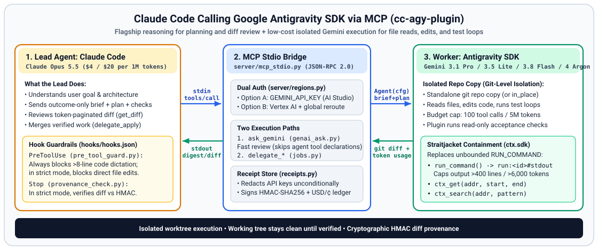
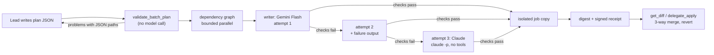

# `cc-agy-plugin`: Call Google Antigravity SDK from Claude Code via MCP



`cc-agy-plugin` connects two coding agent harnesses over the Model Context Protocol (MCP): **Claude Code** acts as the lead engineer, while **Google Antigravity SDK** (defaulting to `gemini-3.1-pro-preview` for worker delegations and `gemini-2.5-flash` for single-shot reviews, with support for `gemini-3.5-flash-lite`, `gemini-3.8-flash`, and `gemini-4-argon`) acts as the execution worker inside an isolated copy of your repository.

---

## Architecture & Trade-Offs: Why Connect Two Harnesses?

`cc-agy-plugin` connects Claude Code to the Google Antigravity SDK so a single workspace can combine Anthropic and Gemini models with strict worktree isolation and cryptographic diff provenance:

1. **Claude Opus 5.5 plans and reviews**:
   - Reads the user prompt, inspects key interfaces, and writes a short outcome-only task brief with ordered `plan` steps and read-only `acceptance` checks (`pytest`, `ruff`, `mypy`).
   - Reviews the token-paginated git diff returned by the worker and decides whether to merge it (`delegate_apply`) or send follow-up instructions (`delegate_continue`).
2. **Google Antigravity SDK + Gemini executes in an isolated copy**:
   - Spins up a headless Antigravity agent inside a standalone git repository copy (or `in_place` when requested).
   - **Straitjacket (`ctx-harness`) shell containment** intercepts noisy test and build outputs (>240 lines or >4,000 tokens), stores them in a local evidence store (`run:<id>#stdout`), and gives the worker `ctx_get` and `ctx_search` tools so a single failing test suite does not flood the worker's context window.
3. **Your working tree stays clean until verified (Git-Level Isolation)**:
   - In the default isolated mode (`in_place=false`), the worker edits a standalone copy of tracked files under `<data_dir parent>/.cc-agy-worktrees-<slug>/<job_id>` (falling back to `/tmp/cc-agy-worktrees-<slug>/<job_id>`), so failed or timed-out runs leave uncommitted files in your checkout untouched. Changes are only merged when `delegate_apply` verifies baseline SHA-256 hashes (using a 3-way merge when needed) and records an HMAC-SHA256 signed receipt.
   - *Security note*: Isolated copies provide git-level checkout isolation, not an OS container or VM sandbox. Worker shell commands run with your local user account's OS permissions; HMAC receipts and child-env scrubbing enforce workflow provenance and prevent accidental secret leakage, not isolation against a hostile local process running as the same OS user. The plugin snapshots and restores host `.git/hooks` and `.git/config` around every run.

### Configured Rate Card

Configured model rates in `server/regions.py` per 1M tokens (for single model calls exceeding `200,000` prompt tokens on Pro/Argon models, such as `ask_gemini` with `single_request=True` or an individual per-step call, input rates scale by `2.0x` and output rates by `1.5x`; multi-call worker turns accumulate smaller per-step prompts at the standard rate):

| Model | Role | Uncached Input / 1M | Cached Input / 1M | Output / 1M |
|---|---|---|---|---|
| **Claude Opus 5.5** | Lead Planner & Reviewer (Unverified assumed proxy list rate) | $4.00 | $0.40 | $20.00 |
| **Gemini 3.1 Pro / Gemini 4 Argon** | Frontier Reasoning Worker (Default) | $2.00 | $0.20 | $12.00 |
| **Gemini 3.8 Flash** | Fast Daily Coding Worker | $0.50 | $0.05 | $3.00 |
| **Gemini 3.5 Flash-Lite** | High-Volume Execution Worker | $0.10 | $0.01 | $0.40 |
| **Gemini 2.5 Flash** | Single-Shot Review (`ask_gemini` Default) | $0.30 | $0.03 | $2.50 |

Every tool call writes a signed receipt with token usage. `/cc-agy-plugin:cost` reports cumulative workspace spend in USD and cents based on the rate table in `server/regions.py`, and the `cost_report` tool adds your Claude Code session's own cost on top for the true total.

---

## Quick Start

### Option A: Google AI Studio API Key (Fastest Setup)

If you have a Gemini API key from [Google AI Studio](https://aistudio.google.com), no Google Cloud project or `gcloud` CLI is required:

```bash
# 1. Install the plugin and its Antigravity + Straitjacket dependencies
python3 -m pip install -e ".[antigravity]"
# (Or directly: python3 -m pip install google-genai pydantic google-antigravity ctx-harness)

# 2. Export your Gemini API key (or set userConfig.gemini_api_key in Claude Code)
export GEMINI_API_KEY="your-api-key-here"

# 3. Launch Claude Code with the plugin loaded
cd /path/to/your/repo
claude --plugin-dir /path/to/cc-agy-plugin
```

### Option B: Google Cloud Vertex AI (ADC / Service Account)

If you use Google Cloud enterprise billing or service accounts:

```bash
# 1. Install the plugin and its Antigravity + Straitjacket dependencies
python3 -m pip install -e ".[antigravity]"

# 2. Authenticate with Google Cloud Application Default Credentials
# Note: unset GEMINI_API_KEY / GOOGLE_API_KEY if set in your shell so Vertex AI is selected by default
unset GEMINI_API_KEY GOOGLE_API_KEY
gcloud auth application-default login
export GOOGLE_CLOUD_PROJECT="your-gcp-project-id"

# 3. Launch Claude Code with the plugin loaded
cd /path/to/your/repo
claude --plugin-dir /path/to/cc-agy-plugin
```

### Authentication Precedence

`resolve_auth_config()` in `server/regions.py` selects the authentication mode in this order:
1. Explicit `api_key` argument on the tool call -> **Google AI Studio** (`auth_mode="api_key"`).
2. Explicit `project` argument on the tool call -> **Vertex AI** (`auth_mode="vertex"`).
3. `GEMINI_API_KEY`, `GOOGLE_API_KEY`, or `CLAUDE_PLUGIN_OPTION_GEMINI_API_KEY` in the environment -> **Google AI Studio** (`auth_mode="api_key"`, even if `GOOGLE_CLOUD_PROJECT` is also exported in the shell).
4. `GOOGLE_CLOUD_PROJECT`, `VERTEX_PROJECT`, `GCLOUD_PROJECT`, `CLOUD_ML_PROJECT_ID`, or `CLAUDE_PLUGIN_OPTION_GOOGLE_CLOUD_PROJECT` in the environment -> **Vertex AI** (`auth_mode="vertex"`).

### Default Models & Overrides

- **`delegate_start` / `delegate_to_gemini`**: defaults to `gemini-3.1-pro-preview` (override per call with `model="gemini-3.5-flash-lite"`, `model="gemini-3.8-flash"`, or `model="gemini-4-argon"`, or globally via `CC_AGY_DEFAULT_DELEGATE_MODEL` / `userConfig.default_delegate_model`).
- **`ask_gemini`**: defaults to `gemini-2.5-flash` (override per call with `model=...` or globally via `CC_AGY_DEFAULT_ASK_MODEL` / `userConfig.default_ask_model`).

Inside Claude Code, run `/mcp` to verify the `vertex` MCP server is connected, then try:
> *"Use `delegate_start` with `model="gemini-3.5-flash-lite"` to add a `hello()` function in `hello.py`, inspect the change with `get_diff`, and apply it with `delegate_apply`."*

---

## How One Harness Calls the Other (End-to-End Flow)

1. **Hook Pre-Flight Check (`scripts/pre_tool_guard.py`)**:
   - A pre-flight linter always rejects delegation prompts (or `plan` steps) containing more than 8 consecutive lines of code so the lead agent writes concise outcome briefs instead of dictating implementation code into the prompt.
   - When strict mode is enabled (`CC_AGY_STRICT_MODE=true` or `userConfig.strict_delegation_mode=true`), Claude Code's direct `Edit`/`Write`/`MultiEdit`/`NotebookEdit` tools and mutating `Bash` commands on workspace files are blocked so implementation work goes through Gemini workers.
2. **MCP Stdio Request (`server/mcp_stdio.py`)**:
   - Claude Code sends a JSON-RPC 2.0 `tools/call` message over `stdin` to the plugin's persistent Python process.
   - An 8-worker thread pool dispatches `tools/call` requests concurrently (up to 8 simultaneous in-flight tool calls) so `delegate_status`, `ping`, and `delegate_cancel` can respond while a worker job is running.
3. **Isolated Copy Snapshot & Worker Execution (`server/jobs.py`, `server/agy_runner.py`)**:
   - `JobManager` copies tracked and non-ignored files (`git ls-files -co --exclude-standard -z`) into a standalone git repository under `<data_dir parent>/.cc-agy-worktrees-<slug>/<job_id>` (falling back to `/tmp/cc-agy-worktrees-<slug>/<job_id>`) and creates a baseline commit (`git init -b main`).
   - `run_antigravity_worker()` launches `google.antigravity.Agent` with per-turn safety caps (default: `100` tool calls and `5,000,000` total tokens) and Straitjacket's bounded shell tools (`run_command`, `ctx_get`, `ctx_search`). If `ctx-harness` is not installed, the worker falls back to standard Antigravity tools and surfaces `containment: "none"` with a `containment_warning` in the job digest.
4. **Plugin-Run Acceptance Checks & Token-Bounded Diff**:
   - When the worker finishes, the plugin automatically executes any read-only `acceptance` commands (for example, `["pytest -q"]`), cleans up new untracked test artifacts, and returns pass/fail counts with a 600-token output tail.
   - The lead agent inspects changes via `get_diff` (paginated at `4,000` tokens per page, up to `8,000` max, so large diffs never exceed Claude Code's MCP token cap) and merges verified work with `delegate_apply`.
5. **Cryptographic Provenance Check (`scripts/provenance_check.py`)**:
   - Every run writes an HMAC-SHA256 signed receipt in `$CC_AGY_DATA_DIR` / `$CLAUDE_PLUGIN_DATA` (defaulting to `~/.cache/cc-agy-plugin/<workspace-slug>/receipts/<job_id>.json`), with API keys unconditionally redacted and the `.hmac_key` stored outside the worker's worktree hierarchy.
   - When strict mode (`CC_AGY_STRICT_MODE=true`) is enabled, the `Stop` hook verifies that every modified line in the workspace matches a signed worker receipt (or pre-existing session baseline).

---

## MCP Tools Reference

| Tool | Purpose |
|---|---|
| `ask_gemini` | Fast single-shot query via `google-genai` (without loading the Antigravity SDK's agent prompt and tool declarations). Best for code reviews, architecture checks, and second opinions. Default model: `gemini-2.5-flash`. |
| `delegate_start` | Start an Antigravity worker in a standalone repo copy (or `in_place=true`). Supports `plan`, `acceptance`, `max_tool_calls`, `max_total_tokens`, `thinking_level`, `api_key`, and `project`. Default model: `gemini-3.1-pro-preview`. |
| `delegate_result` | Wait for a background job to finish (default `240s` wait cap so Claude Code's 5-minute prompt cache stays warm) and return its compact digest. |
| `delegate_status` | Inspect live progress signals (`report_to_lead`), token usage, and USD/cents cost for a single `job_id`, or omit `job_id` to list recent jobs and cumulative totals for the active workspace. |
| `get_diff` | Retrieve the unified git diff from a job's worktree, filtered by file or glob and paginated by token budget (`default: 4000`, `max: 8000` tokens per page). |
| `delegate_apply` | Verify host file SHA-256 hashes against the job's baseline, apply the diff (with 3-way merge fallback), back up each target file's pre-apply bytes, record provenance hashes on the HMAC receipt, and clean up the worktree. |
| `delegate_revert` | Undo an applied job (isolated or `in_place`): restore every file it touched to its pre-apply state. Refuses, and writes nothing, if any of those files changed after the apply; `skip_dirty=true` reverts only the clean ones, `dry_run=true` only reports. |
| `delegate_continue` | Send a follow-up instruction into an existing job's worktree (preserving the job's `auth_mode`, `plan`, `acceptance`, and budget caps across turns). After two failed turns in a row (acceptance failed, error or timeout; set `CC_AGY_ESCALATE_AFTER_FAILURES`), the job is escalated to the Lead and further Gemini attempts are refused unless `force_retry=true`. |
| `cost_report` | Dispatched cost (Gemini calls from receipts) vs true total cost (dispatched plus the Claude Code lead session, rebuilt from its transcripts under `~/.claude/projects/<hash>/` or `$CLAUDE_CONFIG_DIR/projects/<hash>/`). Also runs as `python -m server.true_cost --workspace .`. |
| `delegate_cancel` | Cancel an in-flight worker job and remove its temporary worktree. |
| `delegate_file_batch` | Write many files from one Lead-authored plan in a single call: single-shot writers (no exploration), per-task checks in an isolated job copy, retry with the failure output, Claude as the third attempt, compact per-task digest, resumable. Land with `get_diff` + `delegate_apply`. |
| `draft_document` | One new doc from purpose, audience, sections and facts whose quotes are verified verbatim; must contain every section and link only to real paths. |
| `write_tests_from_cases` | One new test file from named cases; every case and expected value must appear verbatim and the test command must pass. |
| `replicate_edit` | Repeat a change you made by hand in one file across other files as exact edits, then run one check. |
| `probe_writers` | Preflight each configured writer with a tiny call; fails fast with the exact fix. |
| `delegate_to_gemini` | Synchronous convenience wrapper: runs `delegate_start(..., wait=true)` and automatically calls `delegate_apply` if `status == "ok"` (leaving `checkpoint`, `needs_input` and escalated jobs unapplied without flagging `is_error`). |

### Cost scope, escalation and undo

- **Dispatched vs true total.** Receipts only see what the plugin sent to Gemini. The Claude Code lead's own loop (reasoning, file reads, reviewing diffs) is billed separately and is often most of the bill. `cost_report` adds it back from the session transcripts, priced per model at Claude list rates (override with `CC_AGY_LEAD_RATES`), and keeps the two figures side by side. Compare setups on true total.
- **Escalate after two failures.** The worker gets two consecutive attempts. On the second failure the digest carries `escalation.escalate_to_lead=true` and a recommendation: the Lead (Opus) takes over with `get_diff`, finishes the work itself, or discards the job.
- **Revert.** `delegate_apply` backs up the pre-apply bytes of every file it writes under `<data_dir>/backups/<job_id>/` and signs their hashes into the receipt. `delegate_revert` restores them and records `reverted_files`; the strict-mode Stop hook treats reverted files as expected to be back at their pre-apply content.

---

## Batch file writing

Large changes usually cost the most where the Lead types file after file. `delegate_file_batch` moves only the typing: the Lead still explores, plans and reviews, then hands the plan over as one JSON file.



**How a task runs**
- A writer gets one task, the files it needs, and the shared context, and must answer with one JSON object: the whole file, or exact `find`/`replace` edits. Nothing is repaired: a wrong path, an empty file, or a `find` that does not match exactly once is rejected and costs an attempt. CRLF files stay CRLF.
- The plugin writes the answer into the job copy and runs the task's checks (own process group, killed whole on timeout, no vendor credentials in the environment). Only a passing file lands.
- Attempts 1 and 2 use the routed writer (`gemini-3.8-flash`, LOW thinking by default; `writer="agent"` uses a writer-only Antigravity agent with a short custom system prompt, FINISH as its only tool and 3 model calls). Attempt 3 uses Claude. Rate limits and 5xx (408, 429, 5xx, 529, read from status codes) wait with jittered backoff capped at 60 s and are not attempts; a reply cut off at the output limit moves to the next writer for free; 401/403 stops the batch with the fix.
- Files every task needs are sent once as a Gemini context cache (1 hour TTL) or as Claude's cached system prompt, and the first task runs alone to warm the cache.
- Every landed task is journaled with its fingerprint and file hash, so re-sending the same plan after an interruption resumes and skips finished tasks at zero cost.
- One HMAC-signed receipt per batch records each task's state, attempts, writer and added-line hashes. `delegate_apply`, `delegate_revert` and the Stop-hook provenance check work exactly as for agent jobs.

**When to use what**

| Change | Route |
|---|---|
| 1 to 5 files | Lead edits directly |
| 6+ files with a clear per-file plan | `delegate_file_batch` |
| Read-only investigation, debugging a failing suite | `delegate_start` |
| One doc, tests from named cases, one edit repeated | `draft_document`, `write_tests_from_cases`, `replicate_edit` |

Settings: `writer`, `model`, `thinking_level`, `claude_writer`, `claude_model`, `max_parallel` per call, or `CC_AGY_BATCH_WRITER`, `CC_AGY_BATCH_MODEL`, `CC_AGY_BATCH_THINKING`, `CC_AGY_BATCH_CLAUDE_MODEL`, `CC_AGY_BATCH_MAX_PARALLEL`. Cost: compare setups with `/cc-agy-plugin:cost --true-total`, which adds your Claude Code session to the dispatched spend.

Inspired by the architect/editor split popularized by Aider and by cheap-first model cascades (FrugalGPT).

---

## Runtime Settings

Every setting below is an environment variable. Strict mode means `CC_AGY_STRICT_MODE=true` (or `userConfig.strict_delegation_mode=true`).

| Variable | Default | What it does |
|---|---|---|
| `CC_AGY_AUTO_APPLY_ON_PASS` | on in strict mode, off otherwise | Applies a finished worker diff automatically when the job is `ok`, changed files, did not fail acceptance and has no scope violations. Set `0` to always apply by hand. |
| `CC_AGY_SALVAGE_ON_SHUTDOWN` | on in bounded Lead sessions | When the MCP server shuts down with no applied job, applies the best unapplied worker edits so a timed-out Lead does not leave an empty patch. |
| `CC_AGY_AUTO_CONTINUE_DIRTY_WORKTREE` | on in strict mode | Routes a second `delegate_start` to `delegate_continue` on the latest paused (`timeout`, `checkpoint`, `needs_input`, failed acceptance) job instead of starting over. |
| `CC_AGY_MIN_VIEW_LINES` | `250` | Widens small `view_file` reads to at least this many lines. `0` disables it. |
| `CC_AGY_QA_REVIEW_MODEL` | unset | Runs a spec-vs-diff QA review with this model before auto-apply (also `qa_review_model` per call). |
| `CC_AGY_TOOL_PROFILE` | `core` in strict mode, `full` otherwise | `core` exposes only the 8 delegation tools, which cuts the MCP tool list from about 6,800 to about 2,500 tokens. |
| `CC_AGY_LEAD_READ_LIMIT` (alias `CC_AGY_MAX_LEAD_READS`) | `2` in strict mode | Caps direct Lead file reads so the Lead delegates instead of reading the repo twice. `0` removes the cap. |
| `CC_AGY_VERTEX_BASE_URL` (alias `GOOGLE_VERTEX_BASE_URL`) | unset | Sends worker and `ask_gemini` calls to a custom Vertex-compatible endpoint, such as a corporate gateway. `CC_AGY_VERTEX_BASE_URL_TOKEN` sets the bearer token it receives. |

Acceptance runs also add existing tests for each changed module (`tests/test_<module>.py` or `<module>_test.py`), and job results include a `next_action` hint for the Lead.

## Isolated Copy vs. `in_place` Mode

- **Isolated copy (default, `in_place=false`)**: Every job runs in its own standalone copy of tracked files under `<data_dir parent>/.cc-agy-worktrees-<slug>/<job_id>` (falling back to `/tmp/cc-agy-worktrees-<slug>/<job_id>`). Multiple jobs can run in parallel, failed runs leave your working tree untouched, and host `.git/hooks` and `.git/config` are snapshot-verified around every run.
- **Direct working-tree mode (`in_place=true`)**: Edits your live checkout directly so the worker can use gitignored virtual environments (`.venv/`, `node_modules/`) without copying them. Requires a clean tracked tree, allows one `in_place` job at a time, automatically restores your original branch and unwinds any worker git commits (`git reset --mixed`) while keeping file edits on disk, and returns a shell-quoted `undo_hint` command to revert if needed.

---

## Repository Layout

```text
cc-agy-plugin/
├── assets/
│   └── architecture.svg     # Cross-harness MCP architecture diagram
├── .claude-plugin/
│   └── plugin.json          # Claude Code plugin manifest + userConfig schema
├── .mcp.json                # Long-lived stdio MCP server definition (600s timeout)
├── server/
│   ├── main.py              # MCP stdio entry point
│   ├── mcp_stdio.py         # Concurrent JSON-RPC 2.0 MCP protocol dispatcher
│   ├── regions.py           # Dual auth (API Key / Vertex), region routing, pricing, token pagination
│   ├── receipts.py          # Atomic finally-safe HMAC receipt store, API key redaction & diff hashing
│   ├── genai_ask.py         # Single-shot google-genai helper
│   ├── agy_runner.py        # Antigravity SDK runner + Straitjacket (ctx.sdk) tool containment
│   ├── jobs.py              # Isolated repo copy, acceptance runner, 3-way apply, auto-apply, salvage
│   ├── repo_map.py          # Commit-keyed repository map ("scout cache") for worker prompts
│   ├── review_bundle.py     # File-backed review evidence bundle and symbol-level diff slicer
│   ├── model_routes.py      # Which model and thinking level does which job
│   ├── batch_plan.py        # Validates the Lead's file-by-file batch plan (no model call)
│   ├── batch_runner.py      # Runs a batch plan inside an isolated job copy
│   ├── batch_journal.py     # Append-only journal so a re-sent batch skips finished files
│   ├── task_graph.py        # Dependency-ordered, bounded-parallel file tasks
│   ├── writers.py           # Single-shot file writers and their fallback ladder
│   ├── verify.py            # Runs verification commands for file tasks
│   ├── assist_tools.py      # Small bounded helper tools for normal chat
│   ├── true_cost.py         # Dispatched cost vs. true total cost
│   └── harness_validator.py # Pre-flight check of prompt budgets, skills, scripts, and hooks
├── skills/
│   └── vertex/
│       └── SKILL.md         # /cc-agy-plugin:vertex skill instructions
├── agents/
│   └── gemini-delegator.md  # Orchestrator subagent (disallowedTools: Write, Edit, ...)
├── commands/
│   ├── delegate.md          # /cc-agy-plugin:delegate slash command
│   ├── jobs.md              # /cc-agy-plugin:jobs slash command
│   └── cost.md              # /cc-agy-plugin:cost slash command
├── hooks/
│   └── hooks.json           # SessionStart, PreToolUse, PostToolUse, and Stop hook registrations
├── scripts/
│   ├── session_start.py     # SessionStart hook: records the per-session baseline
│   ├── pre_tool_guard.py    # Strict mode PreToolUse guard + 9-line code dictation linter
│   ├── post_tool_ledger.py  # PostToolUse MCP audit logger
│   └── provenance_check.py  # Stop-hook git diff vs HMAC-receipt provenance verifier
├── tests/                   # Plugin, batch, writer, assist-tool, and harness guardrail suites
└── LICENSE                  # Apache License 2.0
```

## Running Tests

```bash
pytest tests/test_cc_agy_plugin.py -v
```

## License

Licensed under the Apache License 2.0. See [LICENSE](LICENSE).

## Acknowledgments

Special thanks to Vamsi Ramakrishnan ([github.com/vamsiramakrishnan/straitjacket](https://github.com/vamsiramakrishnan/straitjacket)) for building Straitjacket, whose bounded command execution and addressable evidence retrieval architecture inspired and powers our worker containment pipeline.
