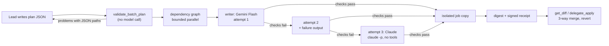

<div align="center">

# cc-agy-plugin

**Keep Claude Code or Codex as your lead architect while fast, low-cost Gemini workers write and test the code in an isolated git copy.**

[](LICENSE)
[](.claude-plugin/plugin.json)
[](tests/)
[](pyproject.toml)
[](#quick-start)

[Why use it](#why-use-it) · [Video walkthrough](#video-walkthrough) · [Quick start](#quick-start) · [How to use it](#how-to-use-it) · [Options](#options) · [Benchmark results](#benchmark-results) · [Technical reference](#technical-reference)

</div>

## Why use it

You already work inside **Claude Code** or **Codex**. Installing `cc-agy-plugin` connects your coding agent to **Gemini 3.8 Flash** and **Gemini 4 Argon** through the Google Antigravity SDK without changing how you type prompts or review diffs.

Your main agent stays in charge of planning and code review. When files need to be written, refactored, or debugged, it hands a short brief to a Gemini worker inside a separate git copy of your repo. The plugin checks that your code compiles and passes tests, merges only verified changes back into your workspace, and writes a signed cost receipt with a one-call undo.

| Without `cc-agy-plugin` | With `cc-agy-plugin` |
|:--|:--|
| Your lead model pays top-tier token rates to read files, type boilerplate, and retry failing tests | Your lead model plans and reviews while **Gemini 3.8 Flash** handles everyday edits and steps up to **Gemini 4 Argon** only on hard failures |
| Failed or interrupted edits leave half-finished changes in your working tree | Workers edit an isolated git copy; broken builds or failed checks never auto-apply |
| Projects without unit tests get no safety net before edits land | Built-in syntax and compile smoke checks still gate Python, TypeScript/JS, Go, Rust, Bash, and JSON changes |
| Monthly API bills arrive as a surprise with no per-task cap | Per-job receipts in US cents, full lead + worker session totals, and an optional daily spend cap (`--max-daily-cents`) |
| No easy way to roll back just one agent run | Every applied job saves pre-edit file backups for a clean one-call revert |

## Video walkthrough

Click the preview below to open the **3m 55s voiced 3D walkthrough** ([`assets/walkthrough.mp4`](assets/walkthrough.mp4), 1080p with audio and burned-in captions; *Any MCP Client* in the diagram includes OpenAI Codex):

<p align="center">
  <a href="assets/walkthrough.mp4">
    
  </a>
</p>

- **`0:00` Keep your workflow:** How Claude Code, Codex, or any MCP client stays in charge while Gemini runs heavy edits next door.
- **`0:32` Isolated git copy and 18 MCP tools:** How `delegate_start`, `delegate_file_batch`, and zero-token `doctor` checks work.
- **`1:22` Four cost-saving habits and Argon step-up:** Cached repo maps, bounded log storage, starting on `gemini-3.8-flash`, and stepping up to `gemini-4-argon` on retries.
- **`2:28` Benchmark walkthrough:** Side-by-side pass rates and cost in cents across Aider Python, SymPy, and DeepSWE repository tasks.

## Quick start

Setup takes about a minute in a normal terminal shell. The installer automatically creates an isolated Python environment at `~/.local/share/cc-agy-plugin/venv`, so you never hit `externally-managed-environment` (PEP 668) errors on Debian, Ubuntu, or macOS Homebrew, and secrets are never written to config files.

### 1. Clone the repository

```bash
git clone https://github.com/manishkjs/cc-agy-plugin && cd cc-agy-plugin
```

### 2. Sign in or set a key (pick one)

```bash
# Option A: Gemini Enterprise work subscription (uses your included monthly seat capacity)
gcloud auth application-default login

# Option B: Google AI Studio API key (fastest personal setup, pay-as-you-go)
export GEMINI_API_KEY="your-key"

# Option C: Google Cloud Vertex AI project (pay-as-you-go)
gcloud auth application-default login
export GOOGLE_CLOUD_PROJECT="your-gcp-project-id"
```

> [!TIP]
> **Using a Gemini Enterprise Standard or Plus license?** Sign in with your human work email (`Option A`) and pass `--auth gemini-enterprise` in Step 3. API keys and Service Account JSON keys belong to a cloud project rather than a human seat, so Google always bills them pay-as-you-go instead of drawing from your included subscription capacity.

### 3. Register with Claude Code or Codex

Run **Path A** or **Path B** in a normal terminal shell (or run `python3 -m server.install` with no flags for a 4-question interactive wizard):

**Path A: Claude Code**
```bash
# With a Gemini Enterprise subscription:
python3 -m server.install --host claude --auth gemini-enterprise

# Or with an AI Studio API key / Vertex AI project:
python3 -m server.install --host claude
```
If `claude` is already open in another terminal tab, run `/reload-plugins` inside that session (or restart with `claude --continue`), or prefix shell commands inside Claude Code with `!`.

**Path B: OpenAI Codex**
```bash
# With a Gemini Enterprise subscription:
python3 -m server.install --host codex --auth gemini-enterprise

# Or with an AI Studio API key / Vertex AI project:
python3 -m server.install --host codex
```

### 4. Verify your setup (free, 0 tokens)

- **In Claude Code:** type `/cc-agy-plugin:doctor`
- **In Codex:** start `codex` in your project and ask: `"Run doctor to verify my Gemini setup."`

## How to use it

<p align="center">
  
</p>

Once installed, open your project in Claude Code or Codex and work normally. Both hosts load the plugin's routing skill automatically, so you do not need to memorize internal MCP tool names.

### Plain-English prompts you can type right away

| What you want to do | Example prompt | What happens behind the scenes |
|:--|:--|:--|
| **Check your setup (free)** | *"Run doctor to verify my Gemini setup."* (or `/cc-agy-plugin:doctor` in Claude Code) | Verifies credentials, active `cost_profile`, installed SDKs, git status, and detected test runner offline at **0 tokens**. |
| **Fix a bug or build a feature** | *"Delegate adding input validation to `api/orders.py` with unit tests, review the diff, and apply it."* | Runs `gemini-3.8-flash` in an isolated git copy (`delegate_start`), runs checks, lets your lead agent inspect `get_diff`, and merges with `delegate_apply`. |
| **Edit many files from one plan (6+ files)** | *"Plan the new webhook handlers across all 8 files and write them with `delegate_file_batch`."* | Validates the plan locally, writes files in parallel with per-file verification, retries failures automatically, and returns one combined diff. |
| **Get a fast second opinion** | *"Ask Gemini to review my current git diff for edge cases and race conditions."* | Sends a single-shot `ask_gemini` query without spinning up a worker copy or touching files. |
| **Undo an applied worker job** | *"Revert worker job `<job_id>`."* | Restores every file touched by that job from its signed pre-apply backup (`delegate_revert`) if no newer manual edits conflict. |

### Slash commands in Claude Code

| Slash command | What it does |
|:--|:--|
| `/cc-agy-plugin:doctor` | Offline readiness check for credentials, SDKs, `cost_profile`, git workspace, and test runner (zero token cost). |
| `/cc-agy-plugin:delegate <task>` | Hands `<task>` to an isolated Gemini worker, verifies checks, inspects the diff, and applies clean results. |
| `/cc-agy-plugin:jobs` | Shows running and recent worker jobs, modified files, token counts, and cost in cents. |
| `/cc-agy-plugin:cost` | Reports workspace Gemini spend in cents (pass `--true-total` to include your full Claude Code session cost via `cost_report`). |

### What if my project does not have tests yet?

Every worker digest reports a `verification` mode so you always know how changes were checked:
- **Projects with tests (`verification: "acceptance_tests"`):** The plugin auto-detects and runs scoped tests across Python (`pytest`, `unittest`), TypeScript/JavaScript (`vitest`, `jest`, `node --test`), Go (`go test`), Rust (`cargo test`), Java/Kotlin (`gradlew`, `mvnw`, `mvn`), and `Makefile`.
- **Projects without tests (`verification: "smoke_only"`):** When no test command is given or detected, the plugin runs fast read-only syntax and compile checks on every changed file (Python parse and import, `tsc --noEmit` with your repo's TypeScript, `node --check`, `go build`, `cargo check --offline`, `bash -n`, and JSON validation). Files that fail to parse or compile are rejected and escalated to `gemini-4-argon`. When smoke checks pass, the digest instructs your lead agent to review the diff line-by-line against your request before finishing.

## Options

### Gemini Enterprise subscription vs API keys and Service Accounts

| How you connect | Uses included Enterprise seat? | How Google bills it | When to use |
|:--|:--:|:--|:--|
| **Gemini Enterprise sign-in** (`gcloud auth application-default login` + `--auth gemini-enterprise`) | **Yes** | Included in your monthly Gemini Enterprise Standard or Plus seat (`businessaicode.googleapis.com`) | Developers whose company assigns Gemini Enterprise seats to their work email. Automatically detects your licensed project and jurisdiction (`global`, `us`, or `eu`). |
| **AI Studio API key** (`GEMINI_API_KEY`) | No | Pay-as-you-go per token on AI Studio | Individual developers without Google Cloud or an enterprise seat. |
| **Vertex AI user or Service Account** (`GOOGLE_CLOUD_PROJECT` / `GOOGLE_APPLICATION_CREDENTIALS`) | No | Pay-as-you-go per token on your GCP billing account (`aiplatform.googleapis.com`) | Headless CI/CD pipelines, shared cloud workloads, or teams paying per token on GCP. |
| **Corporate AI gateway** (`--base-url` / `CC_AGY_VERTEX_BASE_URL`) | Depends on gateway | Managed by your company's gateway (`LiteLLM`, `Portkey`, `Bifrost`, or Apigee) | Enterprises routing model traffic through a central proxy or virtual key. |

### Model and cost profiles (`--profile` or `CC_AGY_COST_PROFILE`)

| Profile | How models are chosen | Best when |
|:--|:--|:--|
| **`balanced`** *(default)* | Starts on fast, low-cost **`gemini-3.8-flash`**. Steps up automatically to **`gemini-4-argon`** on the same git copy if a check fails or a retry is needed, then returns to Flash on the next new task. Quota errors (`429` / `503`) stop automatic retries and hand control back to your lead agent. | Everyday engineering where you want Flash speed and pricing with Argon backup on hard bugs. |
| **`economy`** | Keeps all worker and `ask_gemini` calls on **`gemini-3.8-flash`** and turns off automatic step-up to Argon. | Tight budgets, boilerplate generation, docs, and well-scoped tasks. |
| **`quality`** | Starts all worker and `ask_gemini` calls directly on **`gemini-4-argon`** with deeper reasoning from turn one. | Complex multi-file architecture bugs, subtle concurrency fixes, or tricky math/logic changes. |

### Setup, gateway, budget, and guardrail options

| Option | CLI flag / Environment variable / `userConfig` | Default | What it controls |
|:--|:--|:--|:--|
| **Target coding tool** | `python3 -m server.install --host codex\|claude\|all` | `all` | Registers the MCP server and routing skill for Codex, Claude Code, or both (forwards `--auth`, `--profile`, `--project`, `--location`, `--base-url`, `--max-daily-cents`, and `--strict` directly to both hosts). |
| **Connection mode** | `--auth gemini-enterprise\|api-key\|vertex\|gateway\|auto`, `CC_AGY_AUTH_MODE`, or `userConfig.auth_mode` | `auto` | Set `gemini-enterprise` (`CC_AGY_AUTH_MODE=gemini_enterprise`) to consume your included Gemini Enterprise seat via human Google sign-in instead of pay-as-you-go billing. |
| **AI Studio key** | `GEMINI_API_KEY` or `userConfig.gemini_api_key` | read from shell | Connects directly through Google AI Studio with no Google Cloud setup. |
| **Google Cloud project** | `--project`, `GOOGLE_CLOUD_PROJECT`, or `userConfig.google_cloud_project` | auto-detected on Enterprise; required on Vertex | Optional on Gemini Enterprise (auto-selected from your active license, or used for license self-assignment); required for pay-as-you-go Vertex AI. |
| **Corporate AI gateway** | `--base-url`, `CC_AGY_VERTEX_BASE_URL` (`GOOGLE_VERTEX_BASE_URL`), or `userConfig.vertex_base_url` | unset | Routes Gemini calls through a corporate proxy or AI gateway (with optional bearer token in `CC_AGY_VERTEX_BASE_URL_TOKEN` or `userConfig.vertex_base_url_token`). Takes priority over an ambient shell `GEMINI_API_KEY`. |
| **Cost profile** | `--profile`, `CC_AGY_COST_PROFILE`, or `userConfig.cost_profile` | `balanced` | Selects `balanced`, `economy`, or `quality` model routing. |
| **Daily spend cap** | `--max-daily-cents`, `CC_AGY_MAX_DAILY_CENTS`, or `userConfig.max_daily_cents` | unlimited | Optional workspace daily ceiling in US cents (for example `500` for \$5.00/day). Blocks new Gemini calls once UTC daily receipts reach the limit. |
| **Region / jurisdiction** | `--location`, `GOOGLE_CLOUD_LOCATION`, or `userConfig.google_cloud_location` | `us-central1` (`global`/`us`/`eu` on Enterprise) | Preferred Vertex AI region or Gemini Enterprise jurisdiction (`global`, `us`, or `eu`). |
| **Managed SDK venv** | `CC_AGY_VENV_DIR`, `CC_AGY_PYTHON_BIN`, or `--no-bootstrap` | `~/.local/share/cc-agy-plugin/venv` | Isolated per-user Python environment used by both Codex and cached Claude Code installs (`~/.claude/plugins/cache/...`). |
| **One-off or marketplace install** | `claude --plugin-dir /path/to/cc-agy-plugin` or `codex plugin marketplace add manishkjs/cc-agy-plugin --ref main` | optional | Run in Claude Code for a single session without installing globally, or install via native Codex plugin marketplace. |
| **Model overrides** | `CC_AGY_DEFAULT_DELEGATE_MODEL`, `CC_AGY_DEFAULT_ASK_MODEL` (or `model=` per call) | from `--profile` | Pins worker jobs or single-shot `ask_gemini` calls to a specific Gemini model ID. |
| **Strict orchestrator mode** | `--strict`, `CC_AGY_STRICT_MODE=true`, or `userConfig.strict_delegation_mode` | `false` | Claude Code hook mode that blocks direct host file edits so every modified line traces back to a signed worker receipt. |
| **Working copy mode** | `in_place=false` (isolated copy) vs `in_place=true` (live checkout) per job | `in_place=false` | Isolated copy keeps your checkout clean during runs; `in_place=true` edits your live folder directly when tests depend on large gitignored `.venv/` or `node_modules/` directories. |

## Benchmark results

Early benchmark on **16 real repository tasks** (DeepSWE v1.1), one run each, using the same Gemini model and settings in every setup:

| Setup | Tasks solved | Total cost | Cost per solved task | Model turns |
|:--|:--:|:--:|:--:|:--:|
| Antigravity alone | 10 / 16 | 3,084¢ | 308¢ | 580 |
| **Antigravity + cc-agy-plugin** | 11 / 16 | **2,352¢** | **214¢** | **433** |
| **Claude Code + cc-agy-plugin** | **12 / 16** | 2,984¢ | 249¢ | 598 |

- **Lowest cost:** Antigravity with the plugin solved one more task at **24% lower total cost** and **25% fewer model turns** than running Antigravity alone.
- **Most tasks solved:** Claude Code with the plugin solved **12 of 16** tasks because the lead agent reviews the worker's diff and sends targeted follow-up instructions when an edge case is missed.

> [!NOTE]
> These are early numbers covering 16 of the 33 tasks in the DeepSWE v1.1 suite, one run each.

## Status

| Item | Detail |
|:--|:--|
| **Version** | 0.3.0, Apache 2.0 |
| **Quality** | 278 automated tests (`scripts/validate.sh` checks manifests and badge sync) |
| **Known gap** | If another process force-kills the plugin server (`SIGKILL`), unapplied worker edits in temporary copies are not auto-applied |
| **Next** | Finish the full 33-task DeepSWE suite and publish per-pattern cost guidance |

---

## Technical reference

Internals, rate cards, and full tool documentation for engineers. Click any section below to expand it.

<details>
<summary><b>Architecture and rate card</b></summary>


`cc-agy-plugin` connects Claude Code, Codex, and MCP clients to the Google Antigravity SDK so a single workspace can combine a lead planner/reviewer with Gemini workers under git worktree isolation and cryptographic diff provenance:

1. **Your lead agent plans and reviews**:
   - Reads the user prompt, inspects key interfaces, and writes a short outcome-only task brief with ordered `plan` steps and read-only `acceptance` checks (`pytest`, `ruff`, `mypy`, `go test`, `vitest`).
   - Reviews the token-paginated git diff returned by the worker and decides whether to merge it (`delegate_apply`) or send follow-up instructions (`delegate_continue`).
2. **Google Antigravity SDK + Gemini executes in an isolated copy**:
   - Spins up a headless Antigravity agent inside a standalone git repository copy (or `in_place` when requested).
   - **Straitjacket (`ctx-harness`) shell containment** intercepts noisy test and build outputs (>400 lines or >6,000 tokens), stores them in a local evidence store (`run:<id>#stdout`), and gives the worker `ctx_get` and `ctx_search` tools so a single failing test suite does not flood the worker's context window.
3. **Your working tree stays clean until verified (Git-Level Isolation)**:
   - In the default isolated mode (`in_place=false`), the worker edits a standalone copy of tracked files under `<data_dir parent>/.cc-agy-worktrees-<slug>/<job_id>` (falling back to `/tmp/cc-agy-worktrees-<slug>/<job_id>`), so failed or timed-out runs leave uncommitted files in your checkout untouched. Changes are only merged when `delegate_apply` verifies baseline SHA-256 hashes (using a 3-way merge when needed) and records an HMAC-SHA256 signed receipt.
   - *Security note*: Isolated copies provide git-level checkout isolation, not an OS container or VM sandbox. Worker shell commands run with your local user account's OS permissions; HMAC receipts and child-env scrubbing enforce workflow provenance and prevent accidental secret leakage, not isolation against a hostile local process running as the same OS user. The plugin snapshots and restores host `.git/hooks` and `.git/config` around every run.

### Configured rate card

Configured Gemini model rates in `server/regions.py` and Claude lead rates in `server/true_cost.py` per 1M tokens (for single model calls exceeding `200,000` prompt tokens on Pro/Argon models, such as `ask_gemini` with `single_request=True` or an individual per-step call, input rates scale by `2.0x` and output rates by `1.5x`; multi-call worker turns accumulate smaller per-step prompts at the standard rate):

| Model | Role | Uncached Input / 1M | Cached Input / 1M | Output / 1M |
|---|---|---|---|---|
| **Claude Opus** | Lead Planner & Reviewer (`server/true_cost.py`, override via `CC_AGY_LEAD_RATES`) | $5.00 | $0.50 | $25.00 |
| **Gemini 3.8 Flash** | Default Worker & Review Model (`balanced` / `economy`) | $0.50 | $0.05 | $3.00 |
| **Gemini 4 Argon** | Escalation & `quality` Profile Reasoning Worker | $2.00 | $0.20 | $12.00 |
| **Gemini 3.1 Pro** | Supported Pro Preview Model | $2.00 | $0.20 | $12.00 |
| **Gemini 2.5 Flash** | Supported Regional Review Model | $0.30 | $0.03 | $2.50 |

Every tool call writes a signed receipt with token usage. `/cc-agy-plugin:cost` reports cumulative workspace spend in USD and cents based on `server/regions.py`, and `/cc-agy-plugin:cost --true-total` (`cost_report`) adds your Claude Code session's own cost from `server/true_cost.py` alongside it for the full session total.

---

</details>

<details>
<summary><b>Authentication precedence and cost profiles</b></summary>

### Authentication precedence

`resolve_auth_config()` in `server/regions.py` selects credentials in this exact order:
1. Explicit `api_key` argument on the tool call -> **Google AI Studio** (`auth_mode="api_key"`).
2. Gemini Enterprise subscription mode (`CC_AGY_AUTH_MODE=gemini_enterprise`, `CC_AGY_GEMINI_ENTERPRISE=true`, or `userConfig.auth_mode="gemini_enterprise"`) -> **Gemini Enterprise Business AI Code** (`auth_mode="gemini_enterprise"`). Resolves human Google OAuth credentials (`gcloud auth application-default login`), looks up your active seat via `GET /v1beta:fetchLicenses` (or idempotent `:selfAssignLicense` when `--project` is passed), rejects Service Account keys with remediation instructions, and routes SDK requests through an authenticated `127.0.0.1` loopback proxy to `businessaicode.googleapis.com` (`global`, `us`, or `eu`).
3. Explicit `project` argument on the tool call -> **Vertex AI** (`auth_mode="vertex"`).
4. Custom AI gateway base URL (`CC_AGY_VERTEX_BASE_URL`, `GOOGLE_VERTEX_BASE_URL`, or `userConfig.vertex_base_url`) -> **Vertex-compatible AI Gateway** (`auth_mode="vertex"`, defaulting `project` to `"custom-endpoint"` when no GCP project ID is set, and attaching `CC_AGY_VERTEX_BASE_URL_TOKEN` when configured). Takes priority over an ambient shell `GEMINI_API_KEY`.
5. `GEMINI_API_KEY`, `GOOGLE_API_KEY`, or `userConfig.gemini_api_key` in the environment -> **Google AI Studio** (`auth_mode="api_key"`, even if `GOOGLE_CLOUD_PROJECT` is also exported in the shell).
6. `GOOGLE_CLOUD_PROJECT`, `VERTEX_PROJECT`, `GCLOUD_PROJECT`, `CLOUD_ML_PROJECT_ID`, or `userConfig.google_cloud_project` in the environment -> **Vertex AI** (`auth_mode="vertex"`).

### Cost profiles, quota handling, and overrides

Set `userConfig.cost_profile` in Claude Code, `--profile` in `cc-agy-install`, or `CC_AGY_COST_PROFILE` in your environment:
- **`balanced` (default)**: `delegate_start`, `delegate_to_gemini`, and `ask_gemini` start on `gemini-3.8-flash` (`LOW` thinking on mutating worker turns, `HIGH` on read-only worker turns). Worker jobs (`delegate_start`, `delegate_to_gemini`, `delegate_continue`) automatically step up to `gemini-4-argon` (preserving the job's `thinking_level`) on retries, failed checks, or overlapping follow-up fixes; worker quota errors (`429` / `503`) immediately return `escalate_to_lead=true` (`reason="quota_or_rate_limit"`) without burning retries unless `force_retry=true` is passed. Unrelated follow-on tasks in the same session return to `gemini-3.8-flash`.
- **`economy`**: keeps all worker and `ask_gemini` calls on `gemini-3.8-flash` and disables automatic step-up to `gemini-4-argon`.
- **`quality`**: starts `delegate_start`, `delegate_to_gemini`, and `ask_gemini` directly on `gemini-4-argon` (`MEDIUM` thinking on mutating worker turns, `HIGH` on read-only worker turns).
- **Explicit overrides**: pass `model="gemini-3.8-flash"` or `model="gemini-4-argon"` per call, or set `CC_AGY_DEFAULT_DELEGATE_MODEL` / `CC_AGY_DEFAULT_ASK_MODEL`.

---

</details>

<details>
<summary><b>End-to-end flow (hooks, MCP, isolation, provenance)</b></summary>

1. **Hook pre-flight check (`scripts/pre_tool_guard.py`)**:
   - A pre-flight linter rejects delegation prompts (or `plan` steps) containing more than 8 consecutive lines of code so the lead agent writes concise outcome briefs instead of pasting full implementations into the prompt.
   - When strict mode is enabled (`CC_AGY_STRICT_MODE=true` or `userConfig.strict_delegation_mode=true`), Claude Code's direct `Edit`/`Write`/`MultiEdit`/`NotebookEdit` tools and mutating `Bash` commands on workspace files are blocked so implementation work goes through Gemini workers.
2. **MCP stdio request (`server/mcp_stdio.py`)**:
   - The host sends JSON-RPC 2.0 `tools/call` messages over `stdin` to the plugin's persistent Python process.
   - An 8-worker thread pool dispatches `tools/call` requests concurrently (up to 8 simultaneous in-flight tool calls) so `delegate_status`, `ping`, and `delegate_cancel` can respond while a worker job is running.
3. **Isolated copy snapshot and worker execution (`server/jobs.py`, `server/agy_runner.py`)**:
   - `JobManager` copies tracked and non-ignored files (`git ls-files -co --exclude-standard -z`) into a standalone git repository under `<data_dir parent>/.cc-agy-worktrees-<slug>/<job_id>` (falling back to `/tmp/cc-agy-worktrees-<slug>/<job_id>`) and creates a baseline commit (`git init -b main`).
   - `run_antigravity_worker()` launches `google.antigravity.Agent` with per-turn safety caps (default: `40` tool calls on Flash, `100` on Argon/Pro, and `5,000,000` total tokens) and Straitjacket's bounded shell tools (`run_command`, `ctx_get`, `ctx_search`). If `ctx-harness` is not installed, the worker falls back to standard Antigravity tools and surfaces `containment: "none"` with a `containment_warning` in the job digest.
4. **Acceptance checks, compile smoke checks, and token-bounded diffs**:
   - When the worker finishes, the plugin executes any explicit or auto-discovered `acceptance` commands (`verification: "acceptance_tests"`), or falls back to fast read-only compile/syntax smoke checks (`verification: "smoke_only"`), cleans up untracked test artifacts, and returns pass/fail counts with a 600-token output tail.
   - The lead agent inspects changes via `get_diff` (paginated at `4,000` tokens per page, up to `8,000` max, so large diffs never exceed MCP token limits) and merges verified work with `delegate_apply`.
5. **Cryptographic provenance check (`scripts/provenance_check.py`)**:
   - Every run writes an HMAC-SHA256 signed receipt in `$CC_AGY_DATA_DIR` / `$CLAUDE_PLUGIN_DATA` (defaulting to `~/.cache/cc-agy-plugin/<workspace-slug>/receipts/<job_id>.json`), with API keys and gateway tokens unconditionally redacted and the `.hmac_key` stored outside the worker's worktree hierarchy.
   - When strict mode (`CC_AGY_STRICT_MODE=true`) is enabled, the `Stop` hook verifies that every modified line in the workspace matches a signed worker receipt (or pre-existing session baseline).

---

</details>

<details>
<summary><b>MCP tools reference (18 tools)</b></summary>

| Tool | Purpose |
|---|---|
| `ask_gemini` | Fast single-shot query via `google-genai` (without loading the Antigravity SDK's agent prompt and tool declarations). Best for code reviews, architecture checks, and second opinions. Default model: `gemini-3.8-flash` (`gemini-4-argon` when `cost_profile="quality"`). |
| `delegate_start` | Start an Antigravity worker in a standalone repo copy (or `in_place=true`). Supports `plan`, `acceptance`, `max_tool_calls`, `max_total_tokens`, `thinking_level`, `api_key`, and `project`. Default model: `gemini-3.8-flash` (auto-escalating to `gemini-4-argon` on retries). |
| `delegate_result` | Wait for a background job to finish (default `240s` wait cap so Claude Code's 5-minute prompt cache stays warm) and return its compact digest. |
| `delegate_status` | Inspect live progress signals (`report_to_lead`), token usage, and USD/cents cost for a single `job_id`, or omit `job_id` to list recent jobs and cumulative totals for the active workspace. |
| `get_diff` | Retrieve the unified git diff from a job's worktree, filtered by file or glob and paginated by token budget (`default: 4000`, `max: 8000` tokens per page). |
| `delegate_apply` | Verify host file SHA-256 hashes against the job's baseline, apply the diff (with 3-way merge fallback), back up each target file's pre-apply bytes, record provenance hashes on the HMAC receipt, and clean up the worktree. |
| `delegate_revert` | Undo an applied job (isolated or `in_place`): restore every file it touched to its pre-apply state. Refuses, and writes nothing, if any of those files changed after the apply; `skip_dirty=true` reverts only the clean ones, `dry_run=true` only reports. |
| `delegate_continue` | Send a follow-up instruction into an existing job's worktree (preserving the job's `auth_mode`, `plan`, `acceptance`, and budget caps across turns). Under `balanced` routing, a failed Flash turn steps up to `gemini-4-argon`; after two consecutive failed turns on the active model (set `CC_AGY_ESCALATE_AFTER_FAILURES`), or immediately on a `429`/`503` quota error, the job is escalated to the Lead unless `force_retry=true`. |
| `cost_report` | Dispatched cost (Gemini calls from receipts) vs full session total (dispatched plus the Claude Code lead session, rebuilt from its transcripts under `~/.claude/projects/<hash>/` or `$CLAUDE_CONFIG_DIR/projects/<hash>/`). Also runs as `python -m server.true_cost --workspace .`. |
| `delegate_cancel` | Cancel an in-flight worker job and remove its temporary worktree. |
| `delegate_file_batch` | Write many files from one Lead-authored plan in a single call: single-shot writers (no exploration), per-task checks in an isolated job copy, retry with the failure output, Claude as the third attempt, compact per-task digest, resumable. Land with `get_diff` + `delegate_apply`. |
| `batch_task_log` | Retrieve stored check output, writer prompt excerpt, or raw writer response for one task in a `delegate_file_batch` job (`attempt` optional). |
| `draft_document` | One new doc from purpose, audience, sections and facts whose quotes are verified word-for-word; must contain every section and link only to existing paths. |
| `write_tests_from_cases` | One new test file from named cases; every case and expected value must appear as written and the test command must pass. |
| `replicate_edit` | Repeat a change you made by hand in one file across other files as exact edits, then run one check. |
| `probe_writers` | Preflight each configured writer with a tiny call; fails fast with the exact fix. |
| `doctor` | Zero-network readiness check: verifies MCP tools, `cost_profile`, auth config (redacting keys and tokens), daily budget status, installed SDKs, git workspace status, detected language test runner, and receipt store writability. |
| `delegate_to_gemini` | Synchronous convenience wrapper: runs `delegate_start(..., wait=true)` and automatically calls `delegate_apply` if `status == "ok"` (leaving `checkpoint`, `needs_input` and escalated jobs unapplied without flagging `is_error`). |

### Cost scope, escalation, and undo

- **Dispatched vs full session total:** Receipts record what the plugin sent to Gemini. Your lead agent's own loop (reasoning, file reads, reviewing diffs) is billed separately by your host harness. `cost_report` reconstructs Claude Code lead usage from session transcripts, priced per model at list rates (override with `CC_AGY_LEAD_RATES`), and shows both numbers side by side.
- **Escalate after two failures (or immediately on quota limits):** Each active worker model gets up to two consecutive attempts (in `balanced` mode, a failed Flash turn steps up first to `gemini-4-argon`). On the second consecutive failure on the active model, or immediately when Gemini returns a `429` / `503` quota error (`reason="quota_or_rate_limit"`), the digest sets `escalation.escalate_to_lead=true` so the Lead can inspect `get_diff` and finish, pass `force_retry=true`, or discard the job.
- **Revert:** `delegate_apply` backs up the pre-apply bytes of every file it writes under `<data_dir>/backups/<job_id>/` and signs their hashes into the receipt. `delegate_revert` restores them and records `reverted_files`.

---

</details>

<details>
<summary><b>Batch file writing</b></summary>

Large changes usually cost the most where the Lead types file after file. `delegate_file_batch` moves only the typing: the Lead still explores, plans, and reviews, then hands the plan over as one JSON file.



**How a task runs**
- A writer gets one task, the files it needs, and the shared context, and must answer with one JSON object: the whole file, or exact `find`/`replace` edits. Nothing is silently patched: a wrong path, an empty file, or a `find` block that does not match once is rejected and costs an attempt. CRLF files stay CRLF.
- The plugin writes the answer into the job copy and runs the task's checks (own process group, killed whole on timeout, no vendor credentials in the environment). Only a passing file lands.
- Attempts 1 and 2 use the routed writer (`gemini-3.8-flash`, LOW thinking by default; `writer="agent"` uses a writer-only Antigravity agent with a short custom system prompt, FINISH as its only tool, and 3 model calls). Attempt 3 uses Claude. Rate limits and 5xx (`408`, `429`, `5xx`, `529`) wait with jittered backoff capped at 60 s and do not count as failed attempts; a reply cut off at the output limit moves to the next writer for free; `401`/`403` stops the batch with the fix.
- Files needed by every task are sent once as a Gemini context cache (1 hour TTL) or as Claude's cached system prompt, and the first task runs alone to warm the cache.
- Every landed task is journaled with its fingerprint and file hash, so re-sending the same plan after an interruption resumes and skips finished tasks at zero cost.
- One HMAC-signed receipt per batch records each task's state, attempts, writer, and added-line hashes. `delegate_apply`, `delegate_revert`, and the Stop-hook provenance check work identically to agent jobs.

**When to use what**

| Change | Route |
|---|---|
| 1 to 5 files where agent exploration or test debugging is needed | `delegate_start` (or direct Lead edit outside strict mode) |
| 6+ files with a clear per-file plan | `delegate_file_batch` |
| Read-only investigation or second-opinion review | `ask_gemini` (quick) or `delegate_start` (deep repo search) |
| One doc, tests from named cases, one edit repeated across files | `draft_document`, `write_tests_from_cases`, `replicate_edit` |

Settings: `writer`, `model`, `thinking_level`, `claude_writer`, `claude_model`, `max_parallel` per call, or `CC_AGY_BATCH_WRITER`, `CC_AGY_BATCH_MODEL`, `CC_AGY_BATCH_THINKING`, `CC_AGY_BATCH_CLAUDE_MODEL`, `CC_AGY_BATCH_MAX_PARALLEL`.

Inspired by the architect/editor split popularized by Aider and by cheap-first model cascades (FrugalGPT).

---

</details>

<details>
<summary><b>Runtime settings (environment variables)</b></summary>

Every setting below is an environment variable. Strict mode means `CC_AGY_STRICT_MODE=true` (or `userConfig.strict_delegation_mode=true`).

| Variable | Default | What it does |
|---|---|---|
| `CC_AGY_AUTH_MODE` | `auto` | Set `gemini_enterprise` (or `CC_AGY_GEMINI_ENTERPRISE=true`) to route calls through your included Gemini Enterprise seat (`businessaicode.googleapis.com`) using human Google sign-in. |
| `CC_AGY_COST_PROFILE` | `balanced` | Preset controlling model routing and step-up: `economy` (Flash only), `balanced` (Flash first, Argon on retries/follow-ups), or `quality` (Argon first). |
| `CC_AGY_MAX_DAILY_CENTS` | unset (unlimited) | Optional daily workspace spend cap in US cents (for example `500` for \$5.00/day). Rejects new Gemini calls once UTC daily spend reaches the limit. |
| `CC_AGY_VENV_DIR` / `CC_AGY_PYTHON_BIN` | `~/.local/share/cc-agy-plugin/venv` | Per-user virtualenv directory or explicit Python interpreter path used by the MCP server and installer on PEP 668 systems. |
| `CC_AGY_VERTEX_BASE_URL` (alias `GOOGLE_VERTEX_BASE_URL`) | unset | Sends worker and `ask_gemini` calls to a custom Vertex-compatible endpoint, such as a corporate AI gateway. Takes priority over an ambient shell `GEMINI_API_KEY`. |
| `CC_AGY_VERTEX_BASE_URL_TOKEN` | unset | Optional bearer token or virtual key sent to `CC_AGY_VERTEX_BASE_URL` (redacted from child shells and receipts). |
| `CC_AGY_AUTO_APPLY_ON_PASS` | on in strict mode, off otherwise | Applies a finished worker diff automatically when the job is `ok`, changed files, passed checks, and has no scope violations. Set `0` to always apply manually. |
| `CC_AGY_SALVAGE_ON_SHUTDOWN` | on in bounded Lead sessions | When the MCP server shuts down with no applied job, applies the best verified unapplied worker edits so a timed-out Lead session does not lose finished work. |
| `CC_AGY_AUTO_CONTINUE_DIRTY_WORKTREE` | on in strict mode | Routes a second `delegate_start` to `delegate_continue` on the latest paused (`timeout`, `checkpoint`, `needs_input`, failed acceptance) job when scopes overlap instead of starting over. |
| `CC_AGY_SPARSE_WORKTREE` | off (opt-in via `1` or `CC_AGY_SPARSE_THRESHOLD_FILES=<N>`) | Materializes only scoped directories, directly imported modules, configs, and matching tests for large monorepos when `allowed_paths` is set. |
| `CC_AGY_MIN_VIEW_LINES` | `250` | Widens small `view_file` reads to at least this many lines. `0` disables it. |
| `CC_AGY_QA_REVIEW_MODEL` | unset | Runs a blocker-only spec-vs-diff QA check with this model before auto-apply (also `qa_review_model` per call). |
| `CC_AGY_TOOL_PROFILE` | `core` in strict mode, `full` otherwise | `core` exposes only the 9 core delegation and diagnostic tools, cutting the MCP tool list from about 7,200 tokens to under 1,250 tokens. |
| `CC_AGY_LEAD_READ_LIMIT` (alias `CC_AGY_MAX_LEAD_READS`) | `2` in strict mode | Caps direct Lead file reads so the Lead delegates instead of reading the repo twice. `0` removes the cap. |

</details>

<details>
<summary><b>Isolated copy vs. in-place mode</b></summary>

- **Isolated copy (default, `in_place=false`)**: Every job runs in its own standalone copy of tracked files under `<data_dir parent>/.cc-agy-worktrees-<slug>/<job_id>` (falling back to `/tmp/cc-agy-worktrees-<slug>/<job_id>`). Multiple jobs can run in parallel, failed runs leave your working tree untouched, and host `.git/hooks` and `.git/config` are snapshot-verified around every run.
- **Direct working-tree mode (`in_place=true`)**: Edits your live checkout directly so the worker can use gitignored virtual environments (`.venv/`, `node_modules/`) without copying them. Requires a clean tracked tree, allows one `in_place` job at a time, restores your original branch and unwinds any worker git commits (`git reset --mixed`) while keeping file edits on disk, and returns a shell-quoted `undo_hint` command to revert if needed.

---

</details>

<details>
<summary><b>Repository layout and running tests</b></summary>

```text
cc-agy-plugin/
├── assets/
│   ├── walkthrough.mp4       # 3m 55s voiced 3D walkthrough (1080p H.264 + AAC)
│   ├── walkthrough-poster.png # Clickable preview poster for the README walkthrough
│   ├── overview.svg          # High-level 4-step workflow diagram
│   └── architecture.svg      # Cross-harness MCP architecture diagram
├── .claude-plugin/
│   ├── plugin.json           # Claude Code plugin manifest + userConfig schema
│   └── marketplace.json      # Local Claude Code plugin marketplace catalog
├── .agents/plugins/
│   └── marketplace.json      # Native Codex repository plugin marketplace catalog
├── plugins/cc-agy-plugin/    # Native Codex plugin bundle (.codex-plugin/plugin.json + skill)
├── .mcp.json                 # Long-lived stdio MCP server definition (30-minute / 1,800,000 ms timeout)
├── server/
│   ├── main.py               # MCP stdio entry point + managed venv re-exec
│   ├── runtime_env.py        # PEP 668-safe per-user virtualenv discovery and bootstrap
│   ├── gemini_enterprise.py  # Gemini Enterprise subscription OAuth, license lookup & loopback proxy
│   ├── install.py            # Interactive 4-step wizard + Codex/Claude installer (cc-agy-install)
│   ├── mcp_stdio.py          # Concurrent JSON-RPC 2.0 MCP protocol dispatcher
│   ├── regions.py            # Auth (Enterprise / API key / Vertex / gateway), routing, pricing, daily cap
│   ├── receipts.py           # Atomic HMAC receipt store, secret redaction & diff hashing
│   ├── genai_ask.py          # Single-shot google-genai helper
│   ├── agy_runner.py         # Antigravity SDK runner + Straitjacket (ctx.sdk) tool containment
│   ├── jobs.py               # Isolated repo copy, acceptance + smoke checks, 3-way apply, salvage
│   ├── repo_map.py           # Commit-keyed repository map ("scout cache") for worker prompts
│   ├── review_bundle.py      # File-backed review evidence bundle and symbol-level diff slicer
│   ├── model_routes.py       # Cost profile model and thinking-level routing
│   ├── batch_plan.py         # Validates the Lead's file-by-file batch plan (no model call)
│   ├── batch_runner.py       # Runs a batch plan inside an isolated job copy
│   ├── batch_journal.py      # Append-only journal so a re-sent batch skips finished files
│   ├── task_graph.py         # Dependency-ordered, bounded-parallel file tasks
│   ├── writers.py            # Single-shot file writers and their fallback ladder
│   ├── verify.py             # Runs verification commands for file tasks
│   ├── assist_tools.py       # Small bounded helper tools for normal chat
│   ├── true_cost.py          # Dispatched worker cost vs. full session cost
│   ├── doctor.py             # Offline readiness diagnostics (auth, SDKs, git, test runner, receipts)
│   └── harness_validator.py  # Pre-flight check of prompt budgets, skills, scripts, and hooks
├── skills/vertex/SKILL.md    # Routing skill instructions for Claude Code and Codex
├── agents/gemini-delegator.md # Orchestrator subagent definition
├── commands/                 # /cc-agy-plugin:{delegate,doctor,jobs,cost} slash commands
├── hooks/hooks.json          # SessionStart, UserPromptSubmit, PreToolUse, PostToolUse, and Stop hooks
├── scripts/
│   ├── validate.sh           # Manifest, badge, test-count, and dry-run installer validator
│   ├── session_start.py      # SessionStart hook: records the per-session baseline and --doctor CLI
│   ├── user_prompt_submit.py # UserPromptSubmit hook: records prompt timestamp and resets read budgets
│   ├── pre_tool_guard.py     # Strict mode PreToolUse guard + 9-line code dictation linter
│   ├── post_tool_ledger.py   # PostToolUse MCP audit logger
│   └── provenance_check.py   # Stop-hook git diff vs HMAC-receipt provenance verifier
├── tests/                    # 278 automated unit, integration, portability, and guardrail tests
└── LICENSE                   # Apache License 2.0
```

### Running tests and validation

```bash
pytest tests/ -q          # 278 automated tests
bash scripts/validate.sh  # checks manifests, README badges, and clean-HOME Codex install
```

</details>

### License

Licensed under the Apache License 2.0. See [LICENSE](LICENSE).

### Acknowledgments

Special thanks to Vamsi Ramakrishnan ([github.com/vamsiramakrishnan/straitjacket](https://github.com/vamsiramakrishnan/straitjacket)) for building Straitjacket, whose bounded command execution and addressable evidence retrieval architecture inspired and powers our worker containment pipeline.
