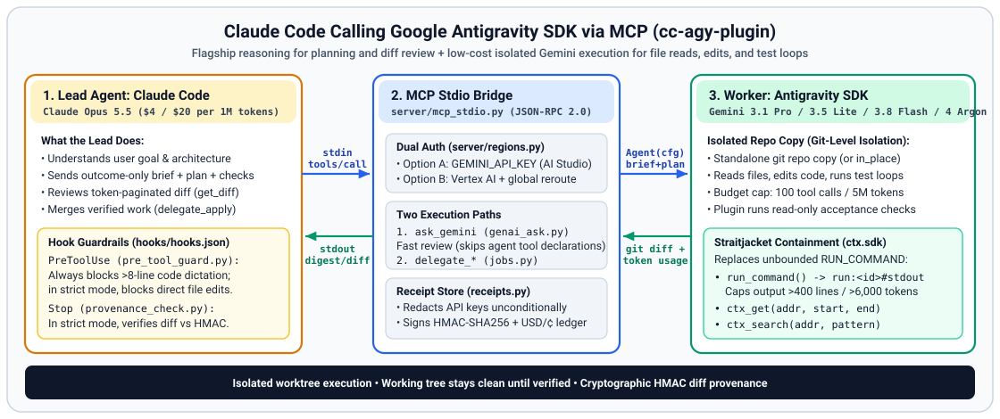
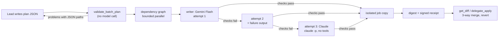

# Technical reference

Internals for engineers: architecture, the rate card, the end-to-end flow, all 18 MCP tools, batch file writing, guard hooks on each host, the repository layout, and how to run the tests.

## Architecture and rate card



`cc-agy-plugin` connects Claude Code, Cursor, OpenCode, Codex, and MCP clients to the standalone Antigravity CLI (`agy`) or Google Antigravity Python SDK so one workspace combines a lead planner/reviewer with Gemini workers:

1. **Your lead agent plans and reviews**:
   - Reads the user prompt, inspects key interfaces, and writes a short outcome-only task brief with ordered `plan` steps and read-only `acceptance` checks (`pytest`, `ruff`, `mypy`, `go test`, `vitest`).
   - Reviews the token-paginated git diff returned by the worker and decides whether to merge it (`delegate_apply`) or send follow-up instructions (`delegate_continue`).
2. **Antigravity (`agy` CLI or Python SDK) + Straitjacket executes the task**:
   - Spins up a headless Antigravity worker inside an isolated git copy (see *End-to-end flow* below for isolation and `in_place=true` details).
   - **Straitjacket (`ctx-harness`) shell containment** intercepts noisy test and build outputs (>400 lines or >6,000 tokens), stores them in a local evidence store (`run:<id>#stdout`), and gives the worker `ctx_get` and `ctx_search` tools so a single failing test suite does not flood the worker's context window.

### Configured rate card

Configured Gemini model rates in `server/regions.py` and Claude lead rates in `server/true_cost.py` per 1M tokens (for single model calls exceeding `200,000` prompt tokens on Pro/Argon models, such as `ask_gemini` with `single_request=True` or an individual per-step call, input rates scale by `2.0x` and output rates by `1.5x`; multi-call worker turns accumulate smaller per-step prompts at the standard rate):

| Model | Role | Uncached Input / 1M | Cached Input / 1M | Output / 1M |
|---|---|---|---|---|
| **Claude Opus 5.5** | Lead Planner & Reviewer (`server/true_cost.py`, override via `CC_AGY_LEAD_RATES`; legacy Opus 4.x/5.0 at 500¢ / 50¢ / 2,500¢) | 400¢ | 20¢ | 2,000¢ |
| **Gemini 4 Hydrogen** (`gemini-4-hydrogen`) | Default Worker & Review Model (`balanced` / `economy`) | 150¢ | 7.5¢ | 750¢ |
| **Gemini 4 Carbon** (`gemini-4-carbon`) | `balanced` Retry Escalation (`gemini-4-carbon-zero`), Opt-in `/prewalk` Guide, & `quality` Profile Reasoning Worker (`gemini-4-carbon`) | 200¢ | 20¢ | 1,200¢ |
| **Gemini 3.1 Pro** | Supported Pro Preview Model | 200¢ | 20¢ | 1,200¢ |
| **Gemini 2.5 Flash** | Supported Regional Review Model | 30¢ | 3¢ | 250¢ |

## End-to-end flow (hooks, MCP, isolation, provenance)

1. **Hook pre-flight check (`scripts/pre_tool_guard.py`)**:
   - A pre-flight linter rejects delegation prompts (or `plan` steps) containing more than 8 consecutive lines of code so the lead agent writes concise outcome briefs instead of pasting full implementations into the prompt.
   - When strict mode is enabled (`CC_AGY_STRICT_MODE=true` or `userConfig.strict_delegation_mode=true`), Claude Code's direct `Edit`/`Write`/`MultiEdit`/`NotebookEdit` tools and mutating `Bash` commands on workspace files are blocked so implementation work goes through Gemini workers.
2. **MCP stdio request (`server/mcp_stdio.py`)**:
   - The host sends JSON-RPC 2.0 `tools/call` messages over `stdin` to the plugin's persistent Python process (negotiating MCP `2024-11-05`, `2025-03-26`, `2025-06-18`, or `2025-11-25`).
   - Three dedicated thread-pool lanes (`control_pool=4` for `delegate_cancel`/`delegate_status`/`doctor`, `wait_pool=8` for `delegate_result`, and `rpc_pool=8` for worker/batch execution) prevent long-running workers from starving cancellation or status calls. Pressing `Esc` (`notifications/cancelled`) immediately invokes `delegate_cancel` on the active worker job, and `_meta.progressToken` streams live step updates (`notifications/progress`).
3. **Working-copy isolation vs. `in_place` execution (`server/jobs.py`, `server/agy_runner.py`, `server/worker_sandbox.py`)**:
   - **Isolated copy (default, `in_place=false`)**: `JobManager` copies tracked and non-ignored files (`git ls-files -co --exclude-standard -z`) into a standalone git repository under `<data_dir parent>/.cc-agy-worktrees-<slug>/<job_id>` (falling back to `/tmp/cc-agy-worktrees-<slug>/<job_id>`) and creates a baseline commit (`git init -b main`). Multiple jobs can run in parallel and failed runs leave your working tree untouched. Host `.git/hooks` and `.git/config` are snapshot-verified around every run. For TypeScript, Node, and Python workspaces, isolated copies populate `node_modules` via copy-on-write clones or bounded package copies (`<= 10,000` entries and `<= 128 MiB`) and expose `<workspace>/.venv/bin` read-only on `PATH`.
   - **Direct working-tree mode (`in_place=true`)**: Edits your live checkout directly when tests depend on large gitignored `.venv/` or `node_modules/` directories without copying them. Requires a clean tracked tree, allows one `in_place` job at a time, cannot be combined with `allowed_paths`, unwinds any worker git commits (`git reset --mixed`) back to your baseline branch while keeping file edits on disk, and returns a shell-quoted `undo_hint`.
   - *Security boundary*: On Gemini Enterprise (`agy` CLI), mutating workers are confined by an OS sandbox (`bwrap` on Linux, `sandbox-exec` on macOS, or `agy --sandbox` fallback on Windows/unprivileged containers; enforce strictly with `CC_AGY_WORKER_SANDBOX=required`). On the Python SDK (`api_key`/`vertex`/`gateway`), Straitjacket (`ctx-harness`) confines tool calls to the job checkout while child-env credential scrubbing and HMAC receipts enforce secret hygiene.
   - **Worker runtime budgets**: `run_antigravity_worker()` launches either `agy --output-format stream-json` (`containment: "agy_cli"`) or `google.antigravity.Agent` (`types.BudgetConfig` + Straitjacket `run_command`/`ctx_get`/`ctx_search`, or `containment: "none"` if `ctx-harness` is absent) with per-turn caps (default: `55` tool calls on Flash in `balanced`, `100` in `economy` and on Argon/Pro, and `5,000,000` total tokens).
4. **Acceptance checks, compile smoke checks, and token-bounded diffs (`server/verification_policy.py`)**:
   - When the worker finishes, the plugin executes any explicit or auto-discovered `acceptance` commands (`verification: "acceptance_tests"` or `"related_tests"`), or falls back to fast read-only compile/syntax smoke checks (`verification: "smoke_only"`), cleans up untracked test artifacts and background child processes, and returns pass/fail counts with a 600-token output tail.
   - The lead agent inspects changes via `get_diff` (paginated at `4,000` tokens per page, up to `8,000` max, so large diffs never exceed MCP token limits) and merges verified work with `delegate_apply`.
5. **Cryptographic provenance check (`scripts/provenance_check.py`)**:
   - Every run writes an HMAC-SHA256 signed receipt in `$CC_AGY_DATA_DIR` / `$CLAUDE_PLUGIN_DATA` (defaulting to `~/.cache/cc-agy-plugin/<workspace-slug>/receipts/<job_id>.json`), with API keys and gateway tokens unconditionally redacted and `.hmac_key` stored outside the worker's worktree hierarchy.
   - When strict mode (`CC_AGY_STRICT_MODE=true`) is enabled, the `Stop` hook verifies that every modified line in the workspace matches a signed worker receipt (or pre-existing session baseline).

## MCP tools reference (18 tools)

| Tool | Purpose |
|---|---|
| `ask_gemini` | Fast single-shot query via `google-genai` (or `agy --mode plan` in `gemini_enterprise` mode) without spinning up a workspace copy. Best for code reviews, architecture checks, and second opinions. Default model: `gemini-4-hydrogen` (`gemini-4-carbon` when `cost_profile="quality"`). |
| `delegate_start` | Start an Antigravity worker in a standalone repo copy (or `in_place=true`). Supports `plan`, `acceptance`, `max_tool_calls`, `max_total_tokens`, `thinking_level`, and `prewalk` (`api_key`/`project` available only when GE mode is not pinned). Default model: `gemini-4-hydrogen` (auto-escalating to `gemini-4-carbon-zero` on retries under `balanced`, or starting on `gemini-4-carbon` under `quality`). |
| `delegate_result` | Wait for a background job to finish (default `240s` wait cap so Claude Code's 5-minute prompt cache stays warm) and return its compact digest. |
| `delegate_status` | Inspect live progress signals (`report_to_lead`), token usage, and USD/cents cost (broken out by `by_auth_mode`: `$0.00` billed for included GE seats vs pay-as-you-go) for a single `job_id`, or omit `job_id` to list recent jobs and cumulative totals. |
| `get_diff` | Retrieve the unified git diff from a job's worktree, filtered by file or glob and paginated by token budget (`default: 4000`, `max: 8000` tokens per page). |
| `delegate_apply` | Verify host file SHA-256 hashes against the job's baseline, apply the diff (using `git merge-file -p` 3-way merge when host files drifted cleanly and re-running acceptance/smoke checks on merged files before writing), back up pre-apply and post-apply snapshots under `<data_dir>/backups/<job_id>/`, record provenance hashes on the HMAC receipt, and clean up the worktree. |
| `delegate_revert` | Undo an applied job (isolated or `in_place`) from its signed `<data_dir>/backups/<job_id>/` snapshot (using 3-way reverse merge when a later job edited non-overlapping lines of the same file). Refuses overlapping edits without writing unless `skip_dirty=true`; `dry_run=true` previews. |
| `delegate_continue` | Send a follow-up instruction into an existing job's worktree (preserving `auth_mode`, `plan`, `acceptance`, and budget caps). Under `balanced`, a failed Flash turn steps up to `gemini-4-carbon-zero`; after two consecutive failures on the active model (`CC_AGY_ESCALATE_AFTER_FAILURES`) or immediately on a `429`/`503` quota error, sets `escalation.escalate_to_lead=true` unless `force_retry=true`. |
| `cost_report` | Dispatched Gemini cost from signed receipts (`$0.00` billed for included Gemini Enterprise seat runs, with `by_auth_mode` token and list-equivalent breakdown) side-by-side with full session cost (Lead session rebuilt from Claude Code `~/.claude/projects/<hash>/` and OpenCode XDG storage). Also runs as `python -m server.true_cost --workspace .`. |
| `delegate_cancel` | Cancel an in-flight worker job (also triggered automatically on MCP `Esc` / `notifications/cancelled`) and remove its temporary worktree. |
| `delegate_file_batch` | Write many files from one Lead-authored plan in a single call: single-shot writers (no exploration), per-task checks in an isolated job copy, retry with the failure output, Claude as the third attempt (disabled automatically when Gemini Enterprise is pinned), compact per-task digest, resumable. Land with `get_diff` + `delegate_apply`. |
| `batch_task_log` | Retrieve stored check output, writer prompt excerpt, or raw writer response for one task in a `delegate_file_batch` job (`attempt` optional). |
| `draft_document` | One new doc from purpose, audience, sections and facts whose quotes are verified word-for-word; must contain every section and link only to existing paths. |
| `write_tests_from_cases` | One new test file from named cases; every case and expected value must appear as written and the test command must pass. |
| `replicate_edit` | Repeat a change you made by hand in one file across other files as exact edits, then run one check. |
| `probe_writers` | Preflight each configured writer with a tiny call; fails fast with the exact fix. |
| `doctor` | Zero-network readiness check: verifies MCP tools, `cost_profile`, auth config (redacting keys and tokens), daily budget status, installed SDKs, git workspace status, detected language test runner, and receipt store writability. |
| `delegate_to_gemini` | Synchronous convenience wrapper: runs `delegate_start(..., wait=true)` and automatically calls `delegate_apply` when `status == "ok"` and behavioral checks pass (leaving `checkpoint`, `needs_input`, and escalated jobs unapplied without flagging `is_error`). |

## Batch file writing

Large changes usually cost the most where the Lead types file after file. `delegate_file_batch` moves only the typing: the Lead still explores, plans, and reviews, then hands the plan over as one JSON file.



**How a task runs**
- A writer gets one task, the files it needs, and the shared context, and must answer with one JSON object: the whole file, or exact `find`/`replace` edits. Nothing is silently patched: a wrong path, an empty file, or a `find` block that does not match once is rejected and costs an attempt. CRLF files stay CRLF.
- The plugin writes the answer into the job copy and runs the task's checks (own process group, killed whole on timeout, no vendor credentials in the environment). Only a passing file lands.
- Attempts 1 and 2 use the routed writer (`gemini-4-hydrogen`, LOW thinking by default; `writer="agent"` uses a writer-only Antigravity agent with a short custom system prompt, FINISH as its only tool, and 3 model calls). Attempt 3 uses Claude. Rate limits and 5xx (`408`, `429`, `5xx`, `529`) wait with jittered backoff capped at 60 s and do not count as failed attempts; a reply cut off at the output limit moves to the next writer for free; `401`/`403` stops the batch with the fix.
- Files needed by every task are sent once as a Gemini context cache (1 hour TTL) or as Claude's cached system prompt, and the first task runs alone to warm the cache.
- Every landed task is journaled with its fingerprint and file hash, so re-sending the same plan after an interruption resumes and skips finished tasks at zero cost.
- One HMAC-signed receipt per batch records each task's state, attempts, writer, and added-line hashes. `delegate_apply`, `delegate_revert`, and the Stop-hook provenance check work identically to agent jobs.

**When to use what**

See the routing table under [When to delegate](../README.md#when-to-delegate) in the README.

Settings: `writer`, `model`, `thinking_level`, `claude_writer`, `claude_model`, `max_parallel` per call, or `CC_AGY_BATCH_WRITER`, `CC_AGY_BATCH_MODEL`, `CC_AGY_BATCH_THINKING`, `CC_AGY_BATCH_CLAUDE_MODEL`, `CC_AGY_BATCH_MAX_PARALLEL`.

Inspired by the architect/editor split popularized by Aider and by cheap-first model cascades (FrugalGPT).

## Repository layout and running tests

```text
cc-agy-plugin/
├── assets/
│   ├── walkthrough.mp4       # 4m 30s voiced 3D walkthrough (1080p H.264 + AAC)
│   ├── walkthrough-poster.png # Clickable preview poster for the README walkthrough
│   ├── overview.svg          # High-level 4-step workflow diagram
│   └── architecture.svg      # Cross-harness MCP architecture diagram
├── .claude-plugin/
│   ├── plugin.json           # Claude Code plugin manifest + userConfig schema
│   └── marketplace.json      # Local Claude Code plugin marketplace catalog
├── .cursor-plugin/
│   ├── plugin.json           # Native Cursor plugin manifest
│   ├── mcp.json              # Cursor stdio MCP config (${CURSOR_PLUGIN_ROOT})
│   └── hooks.json            # Cursor hooks override (prevents scanning Claude hooks)
├── .opencode/
│   ├── skills/cc-agy-plugin/ # Native OpenCode skill (SKILL.md)
│   ├── commands/             # Native OpenCode /agy, /delegate, /doctor, /jobs, /cost, /login commands
│   └── agents/               # Native OpenCode @gemini-delegator subagent
├── .agents/plugins/
│   └── marketplace.json      # Native Codex repository plugin marketplace catalog
├── plugins/cc-agy-plugin/    # Native Codex plugin bundle (.codex-plugin/plugin.json + skill)
├── .mcp.json                 # Long-lived stdio MCP server definition (30-minute / 1,800,000 ms timeout)
├── server/
│   ├── main.py               # MCP stdio entry point + managed venv re-exec
│   ├── runtime_env.py        # PEP 668-safe per-user virtualenv discovery and bootstrap
│   ├── agy_cli.py            # Standalone Antigravity CLI (`agy`) discovery, OAuth check & runner
│   ├── agy_login.py          # Automatic browser loopback & 2-step SSH PKCE OAuth login (1-line link + OSC 52)
│   ├── install.py            # Arrow-key dropdown wizard + Codex/Claude/Cursor/OpenCode/Antigravity installer (cc-agy-install)
│   ├── mcp_stdio.py          # Concurrent JSON-RPC 2.0 MCP protocol dispatcher
│   ├── rate_card.json        # Declarative Gemini & Claude pricing rate card + promo-expiry metadata
│   ├── rate_card.py          # Rate-card validator, promo-expiry check & per-model thinkingLevel clamping
│   ├── regions.py            # Auth (`agy` CLI / API key / Vertex / OIDC gateway), routing, pricing, daily cap
│   ├── receipts.py           # Atomic HMAC receipt store, secret redaction & diff hashing
│   ├── telemetry.py          # Opt-in non-blocking NDJSON / HTTPS receipt sink + verified identity tiers
│   ├── genai_client.py       # Shared google-genai client factory, cleanup & usage normalization
│   ├── genai_ask.py          # Single-shot google-genai / `agy` plan-mode helper
│   ├── agy_runner.py         # Antigravity SDK / `agy` CLI worker runner + Straitjacket containment
│   ├── verification_policy.py # Unified verification classifier for reporting, auto-apply & hooks
│   ├── jobs.py               # Isolated repo copy, acceptance + smoke checks, 3-way apply, salvage
│   ├── repo_map.py           # Commit-keyed repository map ("scout cache") for worker prompts
│   ├── review_bundle.py      # File-backed review evidence bundle and symbol-level diff slicer
│   ├── model_routes.py       # Shared routing table, worker budgets & batch writer settings
│   ├── batch_plan.py         # Validates the Lead's file-by-file batch plan (no model call)
│   ├── batch_runner.py       # Runs a batch plan inside an isolated job copy
│   ├── batch_journal.py      # Append-only journal so a re-sent batch skips finished files
│   ├── task_graph.py         # Dependency-ordered, bounded-parallel file tasks
│   ├── writers.py            # Single-shot file writers and their fallback ladder
│   ├── verify.py             # Runs verification commands for file tasks
│   ├── assist_tools.py       # Small bounded helper tools for normal chat
│   ├── true_cost.py          # Dispatched worker cost vs. full session cost
│   ├── doctor.py             # Offline readiness diagnostics (auth, SDKs, git, test runner, receipts)
│   └── harness_validator.py  # Pre-flight check of prompt budgets, skills, scripts, hooks & doc sync
├── skills/vertex/SKILL.md    # Routing skill instructions for Claude Code and Codex
├── agents/gemini-delegator.md # Orchestrator subagent definition
├── commands/                 # /cc-agy-plugin:{setup,login,agy,delegate,doctor,jobs,cost} slash commands
├── hooks/hooks.json          # SessionStart, UserPromptSubmit, PreToolUse, PostToolUse, and Stop hooks
├── scripts/
│   ├── quickstart.sh         # 1-command clone/update + dropdown setup + OAuth login + --doctor bootstrap
│   ├── agy_signin.sh         # Thin shell wrapper invoking server.agy_login
│   ├── run_mcp_server.sh     # Python 3.10+ MCP launcher (avoids macOS /usr/bin/python3 3.9 crashes)
│   ├── install_agy_cli.sh    # SHA-512 verified standalone Antigravity CLI (`agy`) installer
│   ├── bootstrap-gateway.ps1 # Windows PowerShell enterprise gateway + OIDC setup script
│   ├── sync_docs.py          # Shared routing table & budget constant synchronizer
│   ├── lint_ast.py           # Zero-dependency AST static linter (syntax, bare except, mutable defaults)
│   ├── run_tests_parallel.py # Multi-core parallel pytest runner across all test modules
│   ├── validate.sh           # Manifest, AST lint, badge, doc-sync, and dry-run installer validator
│   ├── session_start.py      # SessionStart hook: records the per-session baseline and --doctor CLI
│   ├── user_prompt_submit.py # UserPromptSubmit hook: records prompt timestamp and resets read budgets
│   ├── pre_tool_guard.py     # Fast-path (<100ms) strict mode PreToolUse guard + prompt linter router
│   ├── post_tool_ledger.py   # PostToolUse MCP audit logger
│   └── provenance_check.py   # Stop-hook git diff vs HMAC-receipt provenance verifier
├── tests/                    # Pytest unit, integration, portability, and guardrail suite
└── LICENSE                   # Apache License 2.0
```

### Guard hooks on every host

The five Claude Code hooks in `hooks/hooks.json` (`SessionStart`, `UserPromptSubmit`, `PreToolUse`, `PostToolUse`, `Stop`) run the same scripts on the other hosts through one adapter, `scripts/hook_adapter.py --host <host> --event <event>`. The adapter turns each host's hook input into the Claude Code shape, runs the script, and turns the answer back into what that host understands (for example, agy blocks with `{"decision":"deny","reason":...}`).

| Host | Where the hooks live | Installed by | What runs |
|---|---|---|---|
| Claude Code | `hooks/hooks.json` (plugin) | the plugin itself | all five hooks, all matched tools |
| OpenCode | `opencode-plugin/hooks.ts` (plugin) | the plugin itself | `tool.execute.before/after`, `chat.message`, `session.created`; `session.idle` cannot block, so Stop only logs |
| Codex 0.118+ | `$CODEX_HOME/hooks.json` (default `~/.codex/hooks.json`) plus `[features] codex_hooks = true` in `config.toml` | `python3 -m server.install --host codex` | `SessionStart`, `UserPromptSubmit`, `PreToolUse` (shell tool `^Bash$` only), `Stop` |
| Antigravity CLI (`agy`) | `~/.gemini/config/hooks.json`, key `cc-agy-plugin` (or the plugin root with `--agy-hooks-scope plugin`) | `python3 -m server.install --host agy` | `SessionStart`, `PreInvocation` (as UserPromptSubmit, once per prompt), `PreToolUse`, `PostToolUse`, `Stop` |
| Cursor | `.cursor-plugin/hooks.json` (plugin) | the plugin itself | nothing yet: Cursor ships no guard hooks, so the read/edit guards and the Stop provenance check do not run there |

How the install works: the installer reads the template (`plugins/cc-agy-plugin/hooks/codex-hooks.json` or `plugins/antigravity/hooks.json`) and writes each `command` with the absolute, shell-quoted paths of your Python and of `scripts/hook_adapter.py`, because neither Codex nor agy expands variables in `command`. It merges by ownership: in Codex it replaces only handlers that run `hook_adapter.py --host codex`, and in agy only the `cc-agy-plugin` key, so your own hooks stay. A changed file is backed up first as `<file>.bak-<timestamp>`. Re-running is a no-op, and `--dry-run` writes nothing.

Codex limits: Codex 0.118 sends `PreToolUse` only for its shell tool, so only shell commands are guarded; the read/edit guards and the MCP `delegate_*` pre-checks do not run there. The installer does not add `PostToolUse` for Codex (it could never match a `delegate_*` call) and removes the one older versions added, so the `delegate_*` hook ledger (`hook_audit.jsonl` and the auto-stop hint) does not run there either. Receipts are not affected: the MCP server writes each job's signed receipt itself, and the Stop-hook provenance check still runs. `codex_hooks` is an "under development" Codex feature; the installer turns it on and leaves it on after `--uninstall-hooks`, since other hooks may need it.

All three hosts let a broken or slow hook through (fail open). The adapter itself denies a `PreToolUse`, or blocks a `Stop` once, only when strict mode is on and a guard script crashes or times out.

The plugin's own workers are never guarded. Every `agy` process the plugin starts gets `CC_AGY_IN_WORKER=1` (set by `build_agy_subprocess_env` in `server/agy_cli.py`), and the adapter returns the host's no-op allow at once when it sees that marker, or when the hook's `cwd` is inside a `.cc-agy-worktrees-` folder. Without this, a worker running with no OS sandbox would load your `~/.gemini/config/hooks.json` and, in strict mode, be denied the very edits it was delegated.

### Running tests and validation

```bash
python3 scripts/run_tests_parallel.py  # run full test suite in parallel across CPU cores (or pytest -n auto -q)
python3 scripts/lint_ast.py            # static AST check across all server/ and scripts/ modules
bash scripts/validate.sh               # checks manifests, AST lint, doc sync, badges, and hermetic host installs
python3 -m pytest -q tests/test_harness_contracts.py -k opencode  # one host's loading contract
```

### One plugin, five hosts: the 3-layer rule

The same plugin loads in Claude Code, Cursor, Codex, OpenCode, and Antigravity, and each host has its own loader quirks (for example, OpenCode rejects any non-function export from its entry file, and `claude plugin install` does not refresh an installed local-marketplace cache). To keep a fix for one host from breaking another, changes follow three layers:

1. **Shared behaviour lives in `server/`.** Every host starts the same stdio MCP server (`server/main.py`, directly or through `scripts/run_mcp_server.sh`).
2. **Host quirks live only in that host's adapter folder:** Claude Code (`.claude-plugin/`, `.mcp.json`, `hooks/`), Cursor (`.cursor-plugin/`, `cursor/rules/`), Codex (`plugins/cc-agy-plugin/.codex-plugin/`, `.agents/plugins/`), OpenCode (`opencode-plugin/`, `.opencode/`, `package.json`), Antigravity (`plugins/antigravity/`, only its hooks template; `server/install.py` writes its `~/.gemini/config/` entries). Adapter files never reference another host's folder.
3. **`server/install.py --host <h>` writes only that host's config.**

Every quirk gets a contract test in `tests/test_harness_contracts.py`. CI runs it once per host (`-k <host>`) on Linux, plus Claude Code and OpenCode on macOS. The tests use a fake `HOME`, a fake `claude` CLI, no network, and no model calls.

[Back to the README](../README.md)
